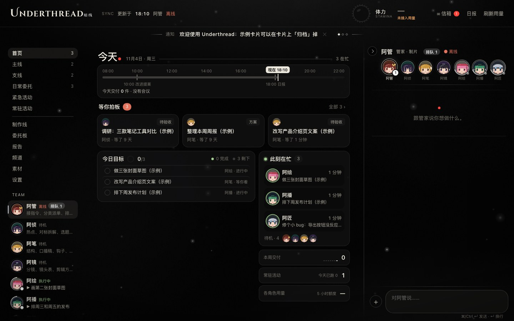
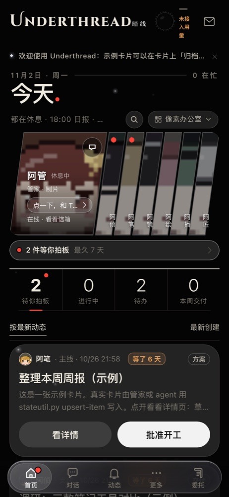
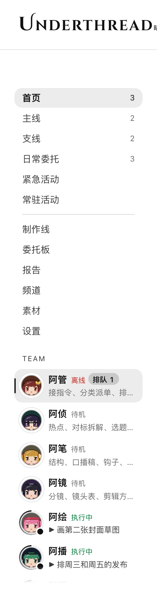

# Underthread

**A personal AI agent team that works 24/7.**

[中文简介](#中文简介)

You talk to one **manager**. It takes your messages, breaks them into tasks, hands them to a team of **specialist agents**, and keeps you in sync on a local **dashboard** you can also use from your phone. The agents do the work and hand back drafts. Your part is to approve, reject or comment.

> Status: early version. The framework runs end to end on one machine. Voice calls and some optional artwork are not part of this repository.



## What it is

- A **long-running manager session** in [Claude Code](https://docs.claude.com/en/docs/claude-code). It watches your inbox, sorts each request, dispatches it and follows up.
- A **team of specialists**: Claude Code subagents, each with its own role notes, rules and memory. You decide what roles you need.
- A **local dashboard** (`server.py` + `web/`): cards, a review queue, chat with the manager and each agent, notifications, and a phone layout.
- **One state file** behind it (`state.json`, written only through `stateutil.py`, with file locking). Nothing leaves your machine unless an agent is asked to call an outside tool.

## Core concepts

| Concept | What it means |
|---|---|
| **Manager** | Your single point of contact. Turns a message into one or more cards, picks the right specialist, dispatches, checks the result and writes a daily report. |
| **Specialists** | Configurable agents (for example a researcher, a writer, a designer, a tooling keeper). Each gets a role file in `roles/` and a subagent file generated from `roster.json`. |
| **Cards** | Every piece of work is a card with a stage (to do → doing → review → done), an owner, a thread and versioned drafts. |
| **Review** | Agents deliver drafts or plans to *review*. You approve, reject with a reason, or answer the clickable questions they attach. Big jobs go through a plan first. |
| **Rules that grow** | When you reject something, the manager turns your reason into a rule proposal. Once you confirm it, it lands in that role's `## Confirmed rules`. |
| **Dashboard** | A dense desktop home (today's timeline, waiting on you, today's goals, working now with an ETA, small counters; the older widget / app / classic homes stay selectable), a lean left rail with each agent's status and duty, card detail with diffs, chat, mailbox, a routines schedule, a 设置 page with tabs, token usage per role, ⌘K palette. Idle animations pause after 20 seconds to save power. |
| **Phone** | The same dashboard as a home-screen web app: tab bar, chat list, pull to refresh, optional Web Push notifications. |

 

## Getting started

Requirements: macOS or Linux, Python 3.10+ (standard library only) and Claude Code.

```bash
git clone https://github.com/dxu2/underthread.git && cd underthread

# 1. The first start copies config.json / roster.json / state.json from the *.example.json files
python3 server.py              # open http://127.0.0.1:8765

# 2. Edit roster.json (names, duties, tone), then generate the agent files
python3 make_agents.py         # writes .claude/agents/ and refreshes the dispatch table in manager.md

# 3. Optional: let the team run stateutil and friends without a prompt each time
cp claude-settings.example.json .claude/settings.json

# 4. In another terminal, start the manager
claude "Start the manager per manager.md"
```

Then write to the manager from the dashboard's chat. See [SETUP-GUIDE.md](SETUP-GUIDE.md) for the full walkthrough (architecture, roles, restarts, optional tools).

To try changes to the UI, run a copy first: `PORT=8799 NO_LOOPS=1 python3 server.py`, never against your real `state.json`.

### Optional tools

- `tools/comfy.py`: image generation through your own ComfyUI box (SSH tunnel).
- `tools/transcribe.py`: voice memo transcription with whisper.cpp.
- `tools/ghcred.py`: store a GitHub push token once from the dashboard (keychain or a 0600 file); set `UNDERTHREAD_GH_REPO=owner/name` for the push check.

## The bundled team preset

The framework itself is general: the manager, cards, review, rules and dashboard don't assume any kind of work. Roles, rules, categories and platforms are all configuration.

What ships in the repository is **one ready-made example preset: a content-creator team** (Bilibili / YouTube / Xiaohongshu). It sets the tone of `manager.md`, `policy.md`, `roles/*.md`, `roster.example.json` (a manager plus six specialists with placeholder names) and `config.example.json`, so you can see a complete team working out of the box.

For a different workflow, edit those files: rewrite the role notes in `roles/*.md`, rename and redefine roles in `roster.json`, adjust `policy.md` and `config.json`, then run `make_agents.py` again. No code changes are needed.

This repository contains no characters from any game or anime; please don't commit other people's characters or artwork.

## Privacy

- **Your data stays local.** Cards, chat, logs, uploads and agent memory live in files in the project folder (`state.json`, `uploads/`, `work/`, `logs/`, `.claude/agent-memory/`) and are all in `.gitignore`.
- The dashboard listens on `127.0.0.1` only. To use it from your phone you have to expose it yourself, for example through a private network such as Tailscale Serve (push notifications need https).
- Secrets are generated or stored locally with mode 600 (`vapid.json` for push, the optional GitHub token) and never sent back to the page.
- The only outside calls are the ones you configure: Claude Code itself, and any optional tool you enable.
- The usage-by-role numbers come from Claude Code's own transcripts on this machine (`~/.claude/projects/<this project>/`); `usage_roll.py` only reads token counts from them and keeps a small rollup in `work/usage/` (ignored by git).

## Ground rules the agents follow

- **Drafts only.** Agents never publish, post, upload or send anything to an outside service on your behalf.
- **Plan first** for big or risky changes; work starts after you approve.
- **Backups** before edits (`name.bak-<tag>`, ignored by git).

## Not included

| Not included | Notes |
|---|---|
| Your data | `config.json`, `roster.json`, `state.json`, `inbox.jsonl`, `uploads/`, `work/`, `logs/`, `avatars/` |
| Keys | `vapid.json` and tokens are created on your machine; never commit them |
| Models | No whisper, ComfyUI or other model weights; follow each model's own license |
| Voice | No voice samples or voice features in this release |
| Artwork | No character art; the UI falls back to text and avatars |

## Changelog

### 2026-11-04
- **Dense desktop home** is the new default: today's timeline, waiting on you, today's goals, working now (with an ETA), small counters; tightened so all five sections fit a 900px-tall window.
- **Lean left rail**: plain text rows instead of a glass panel; each agent row shows a status word and one duty line; today's schedule hides on the dense home.
- **Settings page** with tabs (settings / roles / docs / logs) replaces the separate pages.
- **Usage by role**: tokens per role today (`/api/usage`, `usage_roll.py`) on the home, the phone card and the system panel.
- **Routines page** as a schedule with a 7-day run row; the server now keeps a dated run history (`meta.routines_log`).
- **Power saving**: idle animations pause after 20 s without input; lighter working rings; slower polling in a hidden tab.
- Glass card list (owner avatar first), draft TOC with a sliding indicator, a motion pass so every button and tab has hover / press / switch feedback, click-to-zoom in the image viewer.
- Fixes: one unread count for desktop and phone, no stale 待审核 line in the activity feed, a one-line phone home when nothing waits, readable phone tab pill, wider folded chat rail, no flowing edge rail on busy cards.

## License

Code is [MIT](LICENSE). It covers this repository's code only; models, fonts, voices and images you plug in keep their own licenses.

---

## 中文简介

**Underthread（暗线）：一支 24 小时在线的个人 AI agent 团队。**

你只跟一个「管家」说话。管家接你的消息，拆成任务卡，派给各个专员 agent，并在本地看板上跟你同步。电脑和手机都能用。专员做事、交草稿，你只负责拍板：批准、驳回或评论。

- 核心概念：管家、可配置的专员、卡片与审核、看板（紧凑首页、详情、聊天、信箱、常驻活动日程表、设置页、各角色用量）、手机端。
- 2026-11-04 更新：紧凑首页成为默认、左栏改成克制的文字行、设置页合并成 tab、各角色用量、常驻活动日程表、闲置 20 秒自动暂停动画省电。完整列表见上面的 Changelog。
- 仓库自带的是一套现成的示例团队预设：「内容创作者团队（B站 / YouTube / 小红书）」。框架本身是通用的，想用在别的工作流上，改 `roles/*.md`、`roster.json`、`policy.md` 和 `config.json`，再跑一次 `make_agents.py` 就行，不用改代码。
- 上手：照上面 Getting started 的四步做。详细说明见 [SETUP-GUIDE.md](SETUP-GUIDE.md)。
- 隐私：所有数据都存在本机的项目目录里，并且已经写进 `.gitignore`。看板默认只监听 `127.0.0.1`。
