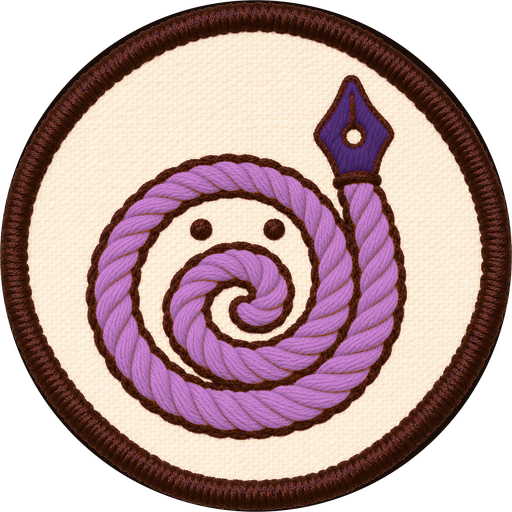
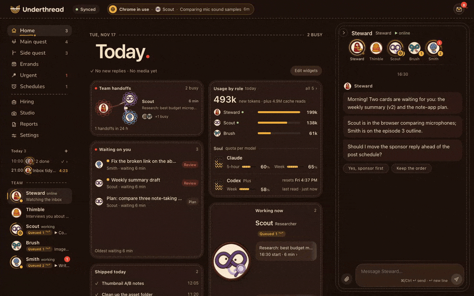
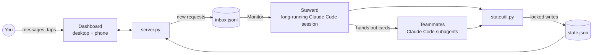

<div align="center">

<picture>
  <source media="(prefers-color-scheme: dark)" srcset="web/brand/wordmark-on-dark@2x.png">
  
</picture>

### Your AI crew, stitched into one inbox.
#### You just say yes, no, or "try again".

**English** · [简体中文](README.zh-CN.md)


[**Try it in 5 minutes**](#try-it-in-5-minutes) · [**Meet the crew**](#meet-the-crew) · [**A day with your crew**](#a-day-with-your-crew) · [**Docs**](#docs)

[](LICENSE)


</div>

**What it is.** Underthread is a local dashboard plus a small team of [Claude Code](https://docs.claude.com/en/docs/claude-code) agents. One long-running Claude Code session, the **steward**, reads what you type in the dashboard, turns it into cards, and hands each card to a specialist subagent. The specialists bring back drafts, plans and files. You approve, reject with a reason, or answer a question.

**Who it's for.** People who already use Claude Code and have more small projects in flight than they can keep in their head: research, writing, planning, small tooling fixes, recurring chores. If you'd rather review a queue than babysit a chat window, it's for you.

**What it costs.** The software is free (MIT). The work is done by Claude Code, so it **uses your own Claude plan's usage**, and the steward stays online all day. Every card a teammate works on spends plan quota. The steward watches the meter: once usage passes 85% it queues new work instead of dispatching it, and at 95% it sleeps until the usage window resets.

<p align="center"></p>

Everything runs on your own machine, and nothing goes out into the world unless you send it yourself.

> **Early days.** The whole loop works end to end on one machine, and there are still rough edges. If you hit one, an issue is very welcome.
>
> Underthread is an independent project. It is **not affiliated with, endorsed by or sponsored by Anthropic**. "Claude" and "Claude Code" are Anthropic's product names.

---

## Meet the crew

The default crew has seven members. Each one has an embroidered patch, and when they're busy they pick up a little tool of their own.

> **Steward = manager.** In files, commands and the roster, the steward's id is `manager` (`manager.md`, `set-agent manager`). The other ids are in the third column.

| | Who | Id | What they do |
|---|---|---|---|
|  | **Steward** | `manager` | Reads every message you send, sorts it into cards, hands them out and writes you a daily report. Rings a tiny bell when there's work. |
|  | **Scout** | `scout` | Research, comparisons and fact-checks, with a source for every claim. Never goes anywhere without a magnifying glass. |
|  | **Quill** | `writer` | Owns every word: docs, drafts, summaries, messages. Turns a page in a little notebook while thinking. |
|  | **Lens** | `director` | Breaks big jobs into steps: plans, checklists, reviews. Snaps a clapperboard when a scene is ready. |
|  | **Brush** | `artist` | Images, diagrams and mockups, optionally through your own ComfyUI machine. Leaves a dab of paint behind. |
|  | **Signal** | `ops` | Your calendar, follow-ups and message drafts. Flies paper planes. |
|  | **Smith** | `smith` | Keeps the dashboard and the tools running, and makes a backup before touching anything. Knits when nothing is on fire. |

Want a different team? Names, duties, tone and the number of teammates all live in `roster.json`, and the Hiring market has 24 ready-made job templates. A Chinese content-creator preset (B站 / YouTube / 小红书: scripts, storyboards, covers, publishing calendar) ships in `presets/content-zh/`; `python3 tools/preset.py apply content-zh` switches to it. See [Make it your crew](#make-it-your-crew).

---

## Try it in 5 minutes

### What you need

| Need | Why |
|---|---|
| macOS or Linux | Windows is untested |
| Python 3.10 or newer | Standard library only, nothing to `pip install` |
| A browser from 2023 or later | The page is ES modules with an import map: Safari / iOS 16.4+, Chrome / Edge 89+, Firefox 108+ |
| [Claude Code](https://docs.claude.com/en/docs/claude-code), signed in to a paid Claude plan | Every teammate is a Claude Code subagent, and the work uses your plan's usage |
| A Claude Code version with the **Monitor** tool | The steward watches `inbox.jsonl` with a background Monitor. Without it, nothing you type in the dashboard gets picked up |
| A usage feed (optional, either one) | In a terminal, Claude Code's `statusLine` runs `tools/statusline.py` (Pro or Max plan). In the Claude desktop app, the steward calls the app's usage tool. Without either, the usage widget says "no usage data" and the 85% / 95% brakes can't kick in |

### Steps

```bash
git clone https://github.com/dxu2/underthread.git && cd underthread
```
<!-- TODO(launch): this URL must resolve before the README goes public (404 on 2026-11-12). -->

> **Just looking?** Run `python3 server.py --demo` and open <http://127.0.0.1:8765>. You get the dashboard with a crew at work and no Claude Code needed: the steward opens cards, teammates light up, log progress and hand in drafts, and whatever you click gets a short canned reply. The demo runs from its own `.demo/` folder, rebuilt on every start, so your real cards are never read or written. Stop it with Ctrl-C. `PORT=8766` picks another port; `--lang zh` or `--lang en` sets the chat language (default: from `$LANG`).

**1. Start the dashboard.**

```bash
python3 server.py
```

The first run copies `config.example.json`, `roster.example.json` and `state.example.json` to `config.json`, `roster.json` and `state.json`.
*You should see:* `Underthread → http://127.0.0.1:8765` in the terminal. Open that address and the home appears with a few example cards. The header says the steward is offline. That's expected until step 3.

**2. Create the agents (required).**

```bash
python3 make_agents.py
```

This writes one Claude Code subagent per teammate into `.claude/agents/` and refreshes the dispatch table in `manager.md`. **Skip it and every dispatch fails**, because the steward has nobody to send work to. Edit `roster.json` first if you want different names or roles; you can re-run it any time.
*You should see:* `from roster.json: wrote 6 agents → …/.claude/agents: underthread-scout, underthread-writer, …` and `restart the manager session to pick them up`. If the dispatch table changed, there is also a line `updated dispatch table in manager.md`.

**3. Wake up the steward.** In a second terminal, from the same folder:

```bash
claude "Start the manager per manager.md"
```

There's nothing to copy: the repository ships `.claude/settings.json`. It lets the crew run their own helper commands without asking you each time, and it feeds your usage to the dashboard. Leave it as it is, and put any permissions of your own in `.claude/settings.local.json` (git ignores it, and Claude Code reads both).
*You should see:* within a few seconds the steward's status in the header turns to online, and a hello appears in the dashboard's chat.

**4. Say something.** Type a request into the chat, the way you'd text a colleague.
*You should see:* a new card appears, and a teammate's patch lights up as they start on it.

Something not working? See [Troubleshooting](docs/troubleshooting.md). The long version of setup, including the phone app, push notifications and ComfyUI, is in [SETUP-GUIDE.md](SETUP-GUIDE.md).

> **Tinkering with the dashboard?** Run a spare copy from a copied folder with `PORT=8799 NO_LOOPS=1 python3 server.py`, so your real cards stay out of harm's way.

---

## A day with your crew

<p align="center"></p>

**09:10 · Just say it.** You type a sentence into the chat. The steward answers, a new card appears, and a teammate gets to work. No form, no template.

<p align="center"></p>

**10:40 · A question, not a wall of text.** Nobody hides a decision on page four of a draft. Scout found three tools worth comparing and wants to know which matters more, price or privacy. You get two buttons, and the one Scout would pick goes first. "Other…" is always there.

<p align="center"></p>

**11:30 · Something big?** Anything long or risky starts as a plan. Nothing happens until you say go.

**14:20 · Reviewing, the easy way.** Every delivery keeps the earlier ones, so you can put v1 and v2 side by side and see exactly what changed. Happy? Accept it.

<p align="center"></p>

**15:05 · "Not like that."** You reject a draft and write one line about why. The steward turns that line into a rule proposal for the teammate who wrote it. Confirm it, and they read it before every job from then on.

<p align="center"></p>

**18:00 · The day in one page.** The steward writes a daily report: what's waiting on you, what shipped, what's still in progress, which rules were adopted, anything that went wrong.

---

## Features at a glance

- **On your phone, too.** Add the dashboard to your home screen and it runs like an app, with push notifications that respect quiet hours. See [Phone and push](docs/phone-and-push.md).

  <p align="center"></p>

- **Schedules in one sentence.** "Remind me tomorrow at 9…" or "every weekday at 9, ask Scout for trends" becomes a schedule on the Schedules page, with on/off switches and a week of run history.
- **Hiring market.** 24 job templates, three personalities each. Hire in one click.
- **⌘K, or just `/`.** Search every card and everything said in chat.
- **One mailbox** for replies, deliveries and notices, with filters.
- **Your look.** The Underthread palette in coffee and cream, or Ink. Night, day or follow the system, plus textures: Stitch, Sweater, Leather, Saddle.

  <p align="center"></p>

- **English or Chinese** interface, switchable in Settings.
- **Archive.** Old finished cards move out of the way so the dashboard stays quick; search still finds them.

---

## Make it your crew

Underthread itself doesn't care what kind of work you do. The steward, cards, reviews, rules and dashboard work the same for any team. Three ways to change the crew:

1. **Hiring market** (in the left rail). Pick a template, click **Hire**, and the new teammate shows up with an avatar, a role note and an agent file. If your roster has an `hr` role, **Interview** lets HR ask you a few questions first.
2. **Command line.** `python3 tools/new_role.py plan|apply|retire|rehire|update`.
3. **By hand.** Edit `roster.json` and `roles/<id>.md`, then run `python3 make_agents.py`.

Teammates can also be moved to a new job (**Transfer**) or retired (**Retire**) from Settings → Roster.

<p align="center"></p>

Full guide, with every roster field and a worked example: [docs/custom-crew.md](docs/custom-crew.md).

---

## What it promises

1. **Drafts only.** The crew never publishes, posts, uploads, comments or sends anything to the outside world. You do that.
2. **Ask before anything big.** Long or risky work starts as a plan and waits for your go.
3. **Hands off your files.** Teammates write new files in `work/<card-id>/`. They don't delete or overwrite your uploads, and they back up code and config before editing.
4. **Your data stays home.** Cards, chats, uploads, logs and memories are files in the project folder, all ignored by git. The dashboard only listens on `127.0.0.1`. Push keys and tokens are created on your machine with mode 600 and never sent to the page. Usage numbers are read from Claude Code on this machine and stay here.
5. **Straight answers.** Every delivery says how sure the teammate is and what they didn't check.

More in [SECURITY.md](SECURITY.md).

---

## How it works



- **One state file.** Everything lives in `state.json`, and only `stateutil.py` writes to it, under a file lock.
- **One inbox.** What you do in the dashboard lands in `inbox.jsonl`. The steward watches it and acts on each entry.
- **A crew from a roster.** `make_agents.py` turns each entry in `roster.json` into a Claude Code subagent.
- **No build step.** Plain HTML, CSS and JavaScript, served by a standard-library Python server.

The full loop, the card lifecycle and where memory lives: [docs/architecture.md](docs/architecture.md).

---

## Docs

| | |
|---|---|
| [SETUP-GUIDE.md](SETUP-GUIDE.md) | Full setup: config, roster, restarts, ComfyUI, tools |
| [docs/architecture.md](docs/architecture.md) | How the pieces talk, card lifecycle, memory |
| [docs/custom-crew.md](docs/custom-crew.md) | Add, change or retire teammates |
| [docs/phone-and-push.md](docs/phone-and-push.md) | Phone app, Tailscale Serve, push notifications |
| [docs/troubleshooting.md](docs/troubleshooting.md) | Troubleshooting and FAQ |
| [CONTRIBUTING.md](CONTRIBUTING.md) | Working on Underthread itself |
| [SECURITY.md](SECURITY.md) | Threat model and how to report a problem |
| [CHANGELOG.md](CHANGELOG.md) | What changed and when |

---

## Roadmap

Ideas being explored, not promises:
- Teammates handing work to each other when one card depends on another.
- Memories you can edit from the dashboard, not only read.
- Approvals with a scope: "yes for this card", "yes for this kind of change".
- Packaging the whole setup as a Claude Code plugin.

Not in this repository: voice calls with the steward (the author's own build has them), and model weights (whisper, ComfyUI models and so on keep their own licences).

---

## License

Code is [MIT](LICENSE). Any models, fonts, voices and images you plug in keep their own licences. The bundled fonts (Nunito, Cinzel) are under the SIL Open Font License 1.1, with licence texts in `web/fonts/`. The Underthread logo, patch avatars and textures were made for this project and contain no third-party artwork.
<!-- TODO(user): confirm the job-template avatars under templates/roles/ and the textures under web/ are covered by the same sentence (r1 W-21). -->

The name and logo identify this project. If you redistribute a modified fork, please give it a different name.

<p align="center"><sub>Built by one person and a crew that never sleeps. Issues and ideas welcome.</sub></p>
