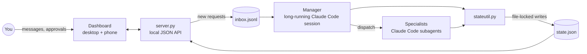
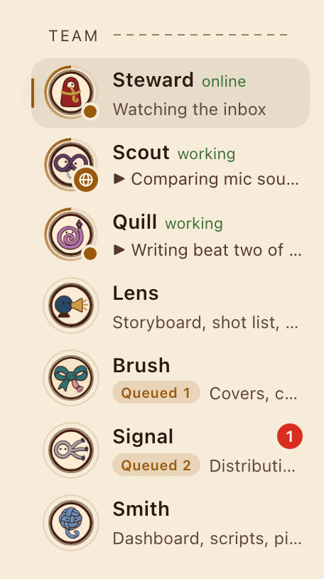
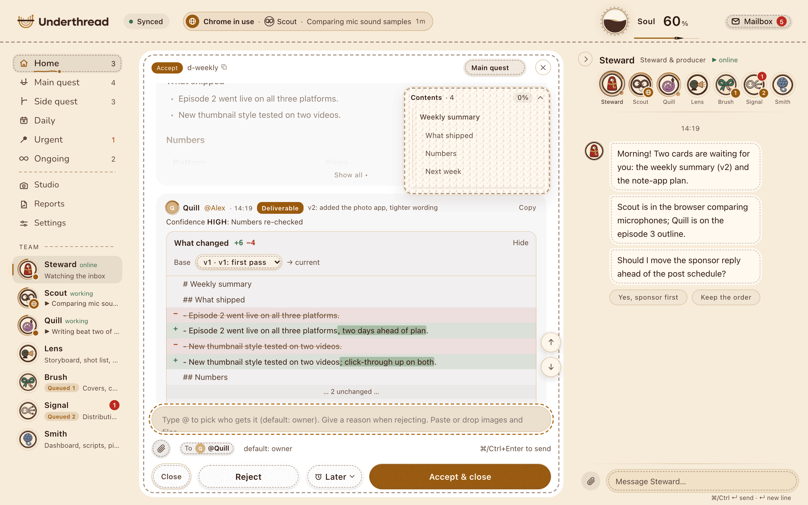
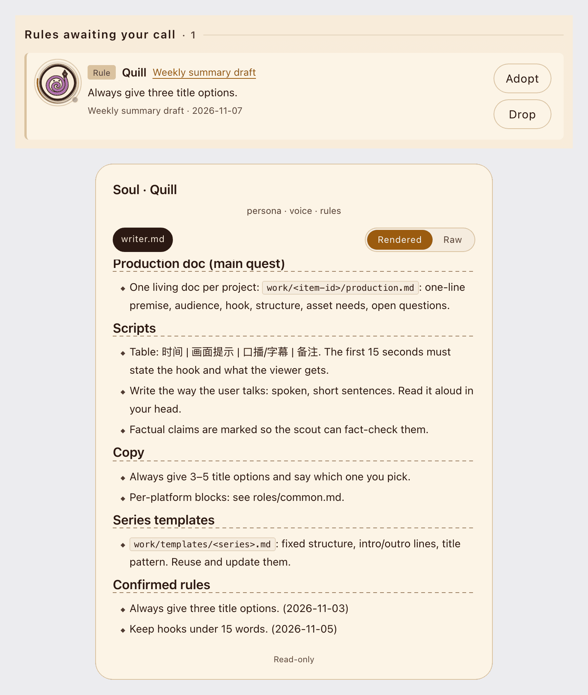
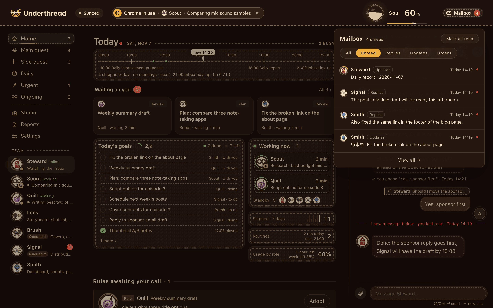
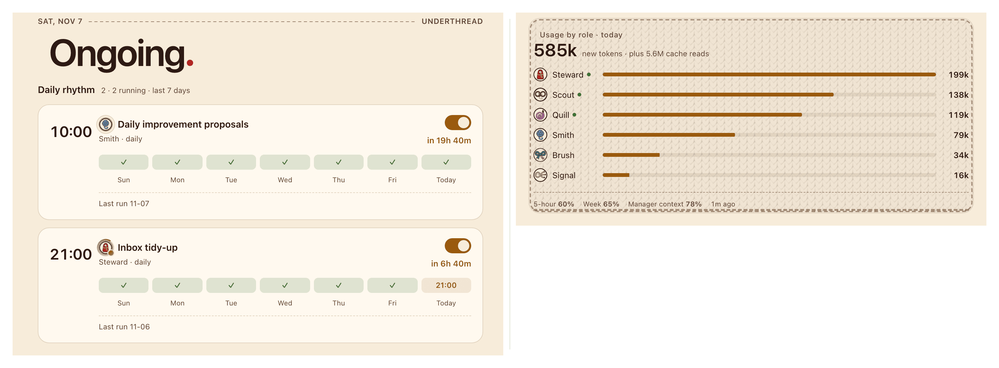
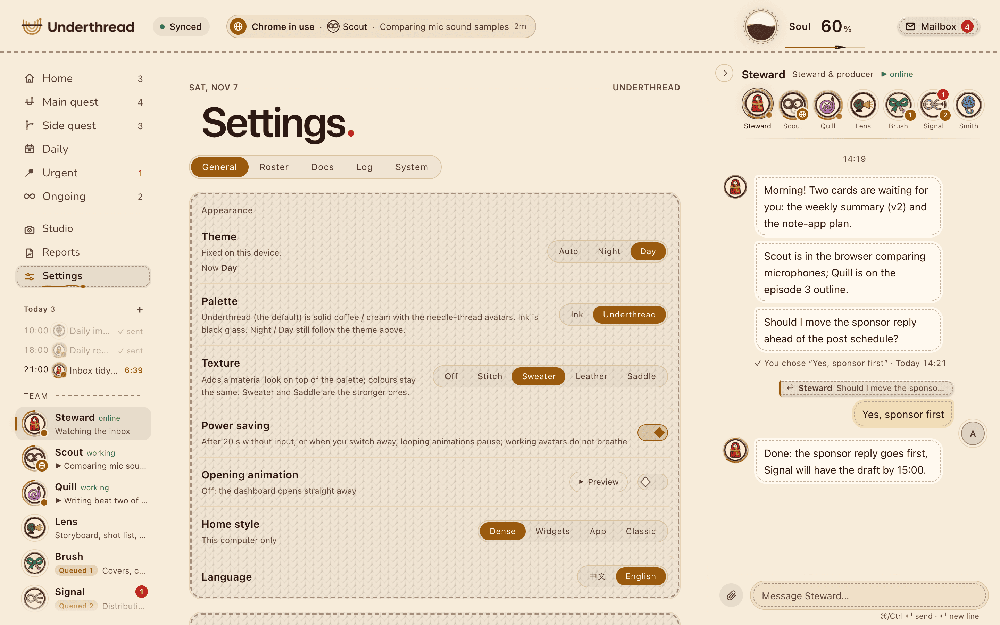
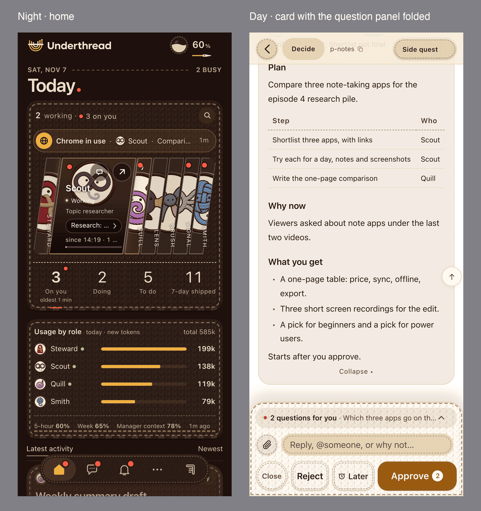
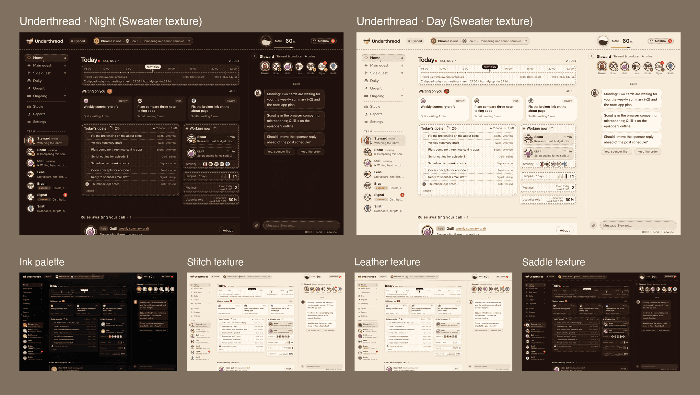

# Underthread

**A personal AI agent team that works 24/7.**

[](LICENSE)


You talk to one **manager**. It turns your messages into cards, hands each card to the right **specialist agent**, and keeps you in sync on a local **dashboard** that also works as a phone app. The specialists do the work and hand back drafts, plans and files. Your part is to approve, reject with a reason, or tap an answer to a question. When you reject something, the reason becomes a rule that the agent follows next time. Everything runs and stays on your own machine.

> **Status: early version.** The whole loop runs end to end on one machine. Expect rough edges, and please open an issue when you hit one.

## Contents

- [Quick start](#quick-start)
- [How it works](#how-it-works)
- [Features](#features)
  - [Manager and specialists](#manager-and-specialists)
  - [Cards and review](#cards-and-review)
  - [Questions you answer with a tap](#questions-you-answer-with-a-tap)
  - [Rules that grow](#rules-that-grow)
  - [Chat and mailbox](#chat-and-mailbox)
  - [Routines, daily report and usage](#routines-daily-report-and-usage)
  - [Desktop dashboard](#desktop-dashboard)
  - [Phone app](#phone-app)
  - [Look: Underthread palette, textures, home styles](#look-underthread-palette-textures-home-styles)
  - [Performance and power](#performance-and-power)
  - [Tools and running it day to day](#tools-and-running-it-day-to-day)
- [The bundled team preset](#the-bundled-team-preset)
- [Privacy and safety](#privacy-and-safety)
- [Not included](#not-included)
- [Roadmap](#roadmap)
- [Changelog](CHANGELOG.md)
- [License](#license)

---

## Quick start

Requirements: macOS or Linux, Python 3.10+ (standard library only) and [Claude Code](https://docs.claude.com/en/docs/claude-code).

```bash
git clone https://github.com/dxu2/underthread.git && cd underthread

# 1. The first start copies config.json / roster.json / state.json from the *.example.json files
python3 server.py              # open http://127.0.0.1:8765

# 2. Edit roster.json (names, duties, tone), then generate the agent files
python3 make_agents.py         # writes .claude/agents/ and refreshes the dispatch table in manager.md

# 3. Optional: let the team run stateutil and friends without a prompt each time
cp claude-settings.example.json .claude/settings.json

# 4. In another terminal, start the manager
claude "Start the manager per manager.md"
```

Then write to the manager from the dashboard's chat. [SETUP-GUIDE.md](SETUP-GUIDE.md) has the full walkthrough: architecture, roles, restarts and optional tools.

**Try changes on a copy first.** `PORT=8799 NO_LOOPS=1 python3 server.py` starts a second dashboard with the background loops off. Never test UI changes against your real `state.json`.

---

## How it works



- **One state file.** Cards, chat, agent status and rules live in `state.json`. Only `stateutil.py` writes to it, under an exclusive file lock, so the server, the manager and every agent can write at the same time without clobbering each other.
- **One inbox.** What you type on the dashboard lands in `inbox.jsonl`. The manager watches it, acknowledges each entry and acts on it.
- **Agents from a roster.** `roster.json` lists the roles. `make_agents.py` turns each one into a Claude Code subagent (`.claude/agents/`) with its own role notes in `roles/` and its own memory folder.
- **No build step.** The dashboard is plain HTML, CSS and JavaScript served by `server.py`, a standard-library Python server.

---

## Features

### Manager and specialists



The manager is your single point of contact. It sorts each request into a card, picks the specialist, dispatches, checks what comes back and follows up. The specialists do the actual work.

- **Configurable roles.** Add, remove or rename roles in `roster.json`: name, title, duty, tone, colour. Run `make_agents.py` and the manager's dispatch table updates with them.
- **Role notes and memory.** Each role reads its notes in `roles/<id>.md` at the start of every job, and keeps a small memory folder for facts it will need again. You can read every agent's memory from the dashboard.
- **Live status.** The left rail shows every agent's state (working, idle), the card it is on and a one-line activity, so you can see at a glance who is busy with what.
- **Browser-in-use badge.** When an agent is driving a browser or the desktop, its row, the home page and the widgets show a badge with the agent and how long it has been at it (`stateutil.py set-agent --tool chrome|computer`).
- **Plan first.** Big or risky jobs (long, many generations, or touching files outside the card's folder) start with a plan. Work only begins after you approve it.

### Cards and review



Every piece of work is a card: a category, an owner, a stage (to do, doing, review, done), a thread and a history of drafts.

- **Versioned drafts.** Each new delivery keeps the old one as a version with a label ("v2: tighter intro"). Any two versions can be compared side by side.
- **Three kinds of delivery.** A *plan* asks for a go-ahead, a *deliverable* is the finished thing, and a *question* means the agent is blocked on you.
- **Waiting on you.** One review queue collects cards that need a decision, plus cards with replies you have not read yet (marked with a new-reply dot). Open the card and it leaves the queue.
- **Attachments.** Images show inline, video plays in place, other files are links. Add them with the attach button or by dropping them on the page.
- **Image viewer.** Click to zoom. On the phone you can save any card image at full size, not the thumbnail.
- **Links just work.** URLs in card text are clickable, including right after Chinese punctuation.
- **Mission complete.** Accepting a delivery plays a short "mission complete" scene. Add your own role art in `web/art/` (a transparent cut-out works best) and it appears there; without art the scene plays without a portrait.
- **Archive.** Done cards that have not moved for a while go to `archive.json`, so the dashboard stays fast. Search still finds them (`stateutil.py archive sweep|list|unarchive-all`).

### Questions you answer with a tap


Agents don't bury decisions in the middle of a draft. They attach clickable questions to the card.

- **Options with a recommendation.** Each question has two to four options. When the agent has a preference it marks one, and that one is shown first.
- **"Other…"** is always there for an answer the agent did not think of.
- **A compact panel.** Open questions sit in a panel at the bottom of the card. On the phone it folds to one line until you open it.
- **Quoted replies.** Tapping a quick option in chat quotes the question it answers, so the thread stays readable later.
- **Withdrawn questions** disappear when they no longer apply (`stateutil.py ask-close`).

### Rules that grow



When you reject something with a reason, the manager turns the reason into a one-line rule proposal for that role. Confirm it and it lands in the role's `## Confirmed rules`, which the agent reads before every job and which override its defaults. Over time the team stops repeating the same mistakes.

### Chat and mailbox



- **Manager chat** on the right of the desktop and as its own tab on the phone.
- **Direct messages** with each specialist.
- **Mailbox** in the top bar: every reply, delivery and notice in one list, with filters (All, Unread, Replies, Updates, Urgent).
- **Your messages as bubbles** in card threads, and a composer that starts one line tall and grows as you type.
- **⌘K palette** (or `/`) to search cards and what was said in chats, and to run actions such as approving a card.
- **Voice memos** (optional): upload a recording and it is transcribed on your machine with whisper.cpp (`tools/transcribe.py`).

### Routines, daily report and usage



- **Routines.** Recurring jobs (`config.json` → `routines`) fire at a set time each day. The routines page shows them as a schedule with a seven-day row of past runs. Pause one with a switch; it never fires twice after a restart.
- **Daily report.** At `report_time` the manager writes a report: what waits on you, what shipped, what is in progress, rules adopted, anything that went wrong.
- **Usage by role.** Today's tokens per role, read from Claude Code's own transcripts on this machine (`usage_roll.py`), on the home page and in Settings.
- **Plan usage.** The stamina orb shows how much of your Claude plan window is left (`tools/statusline.py`). When it runs out, the manager can sleep until the window resets.
- **Wake the manager** from Settings if it is asleep or offline: it drops a ping in the inbox.

### Desktop dashboard



- **Dense home** (the default): today's timeline, waiting on you, today's goals, working now with an ETA, and small counters, all on the first screen.
- **Lean left rail:** your queues (Home, Main quest, Side quest, Daily, Urgent, Ongoing), then Studio, Reports, Mailbox and Settings, then the team.
- **Studio** groups the production pages (Pipeline, Board, Channels, Assets) under one tab.
- **Top bar sync pill:** when the dashboard last synced and whether the manager is online, in one place.
- **Settings in tabs:** General, Roles, Docs, Logs, System. Roles shows each agent's notes and rules; Docs and Logs let you read the project files and server logs; System shows health checks and a GitHub push token you can store once.
- **Chinese or English UI**, switchable in Settings.

### Phone app



The same dashboard, laid out for a phone. Add it to your home screen and it runs as a web app.

- **Floating tab bar:** icons only, a long press shows the name, unread counts are a red dot.
- **Home** with what waits on you, the team panel and what shipped today. When nothing waits, that part folds to one line.
- **Pull to refresh**, and search that also finds finished cards' drafts.
- **Push notifications** (optional, Web Push), set per device: only decisions, decisions plus replies, or everything; quiet hours (23:00–09:00 by default) with a morning digest. They need the page served over https; see [Privacy and safety](#privacy-and-safety).

### Look: Underthread palette, textures, home styles



The dashboard's default look is **Underthread**: solid coffee and cream colours, with no glass. Each role has an embroidered-patch avatar, and the cards have stitched edges, spool-drawn empty states and an optional knit or leather texture. Every screenshot in this README uses it, with the Sweater texture. If you prefer black glass, switch the palette to **Ink** in Settings → Appearance. The avatars live in `avatars/ut/`. To use your own, replace a role's PNG and run `python3 tools/avatar_sizes.py` (it needs `cwebp`).

- **Night, day or auto.** Auto follows your system's light and dark setting.
- **Palette:** Underthread (the default) or Ink. **Texture:** Off, Stitch, Sweater, Leather or Saddle. The textures are generated images, a few KB each, and the colours stay the same.
- **Opening animation:** a needle threads the logo once per session. Tap or press any key to skip it, or turn it off in Settings.
- **Four home styles** on the desktop: Dense, Widgets, App and Classic. The choice is kept per computer.
- **Motion with feedback:** every button, tab and switch responds to hover, press and switch.

### Performance and power

The dashboard is meant to stay open all day, on a laptop and on a phone.

| What | How |
|---|---|
| Fast first open | The page shows a snapshot right away, then fills in |
| Light polling | Polls leave out what you are not looking at; long polling instead of tight loops; older chat, letters and logs load on demand |
| Long-lived cache | Static files carry a version (`?v=`) and are cached for a year |
| Small avatars | `tools/avatar_sizes.py` makes small WebP copies for lists |
| Instant send | Your message shows before the server answers |
| Power saving | After 20 seconds without input, or when the window is in the background, looping animations pause. A switch in Settings turns this off |
| Quiet logs | Dropped connections are counted and summarised once an hour, not logged one by one |
| No font requests | Nunito and Cinzel (Latin subsets, SIL OFL 1.1) are served locally |

### Tools and running it day to day

| Tool | What it does |
|---|---|
| `tools/keepalive.sh` | Runs the dashboard and restarts it if it exits |
| `tools/install_service.sh` | Installs the dashboard as a macOS LaunchAgent (starts at login, restarts if it dies) |
| `tools/ensure_server.py` | Starts the dashboard if it is not answering; safe to run any time |
| `tools/statusline.py` | Claude Code status line that feeds plan usage into the dashboard |
| `tools/comfy.py` | Optional: image generation through your own ComfyUI machine over an SSH tunnel |
| `tools/transcribe.py` | Optional: voice memo transcription with whisper.cpp |
| `tools/ghcred.py` | Optional: store a GitHub push token once (keychain or a 0600 file); set `UNDERTHREAD_GH_REPO=owner/name` for the push check |
| `tools/webpush.py` | Web Push sender used by the server |

---

## The bundled team preset

The framework is general: the manager, cards, review, rules and dashboard don't assume any kind of work. Roles, rules, categories and platforms are all configuration.

What ships in the repository is **one ready-made example preset: a content-creator team** (Bilibili / YouTube / Xiaohongshu) with a steward plus six specialists (researcher, writer, director, artist, growth, tooling keeper), all with placeholder names. It sets the tone of `manager.md`, `policy.md`, `roles/*.md`, `roster.example.json` and `config.example.json`, so you can watch a complete team work out of the box.

For a different workflow, rewrite the role notes in `roles/*.md`, rename and redefine the roles in `roster.json`, adjust `policy.md` and `config.json`, then run `make_agents.py` again. No code changes are needed.

This repository contains no characters from any game or anime. Please don't commit other people's characters or artwork.

---

## Privacy and safety

**Your data stays on your machine.**

- Cards, chat, logs, uploads and agent memory are files in the project folder (`state.json`, `archive.json`, `uploads/`, `work/`, `logs/`, `.claude/agent-memory/`), and all of them are in `.gitignore`.
- The dashboard listens on `127.0.0.1` only. To use it from your phone you expose it yourself, for example over a private network such as Tailscale Serve. Push notifications need https.
- Secrets are generated or stored locally with mode 600 (`vapid.json` for push, the optional GitHub token) and are never sent back to the page.
- Usage numbers come from Claude Code's own transcripts on this machine. `usage_roll.py` reads only the token counts and keeps a small rollup in `work/usage/` (ignored by git).
- The only outside calls are the ones you set up: Claude Code itself, and any optional tool you turn on.

**Ground rules the team follows** (written into each agent file by `make_agents.py`, plus the role notes and `manager.md`):

- **Drafts only.** Agents never publish, post, upload, comment or send anything to an outside service. You do the publishing.
- **Plan first** for big or risky work.
- **Never touch your files.** Agents write new files under `work/<card>/`; they don't delete or overwrite your uploads or anything outside `work/`.
- **Backups before edits** to code and config (`name.bak-<tag>`, ignored by git).
- **Honest confidence.** Each delivery says how sure the agent is and what it did not check.

---

## Not included

| Not included | Notes |
|---|---|
| Your data | `config.json`, `roster.json`, `state.json`, `archive.json`, `inbox.jsonl`, `uploads/`, `work/`, `logs/`, everything in `avatars/` except the bundled `avatars/ut/` set |
| Keys | `vapid.json` and tokens are created on your machine; never commit them |
| Models | No whisper, ComfyUI or other model weights; follow each model's own licence |
| Voice | The author's build has local voice calls with the manager; that code is not in this repository |
| Artwork | No character art. The Underthread avatars, logo and textures ship with the repo. Under the Ink palette, a role with no avatar of yours gets a colour disc with an initial |

---

## Roadmap

Ideas being explored, not promises:

- Specialists handing work to each other when one card depends on another.
- Agent memory you can edit from the dashboard, not only read.
- Approvals with a scope ("yes for this card", "yes for this kind of change").
- Packaging the setup as a Claude Code plugin.

---

## Changelog

See [CHANGELOG.md](CHANGELOG.md).

## License

Code is [MIT](LICENSE). It covers this repository's code only; models, fonts, voices and images you plug in keep their own licences. The bundled fonts (Nunito, Cinzel) are under the SIL Open Font License 1.1; their licence texts are in `web/fonts/`. The Underthread logo, embroidered-patch avatars and textures were made for this project and contain no third-party artwork.
