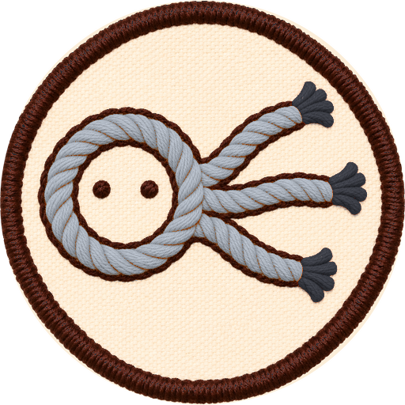
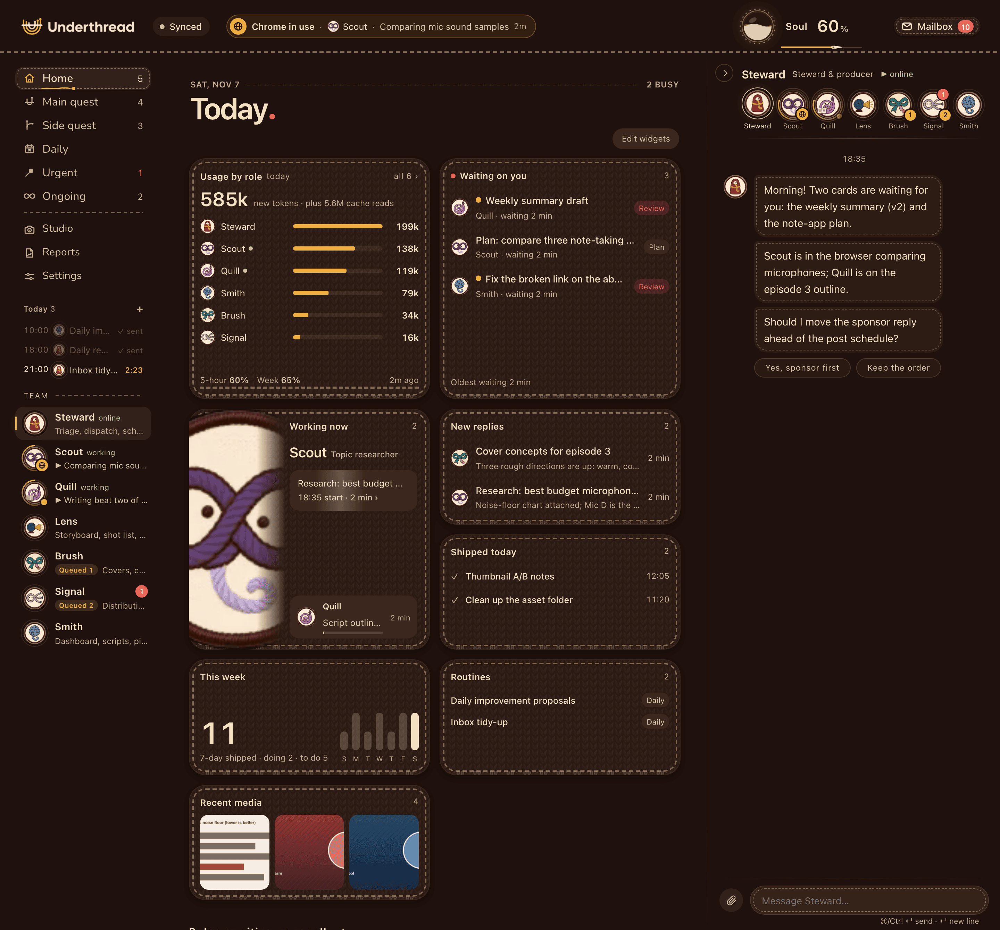
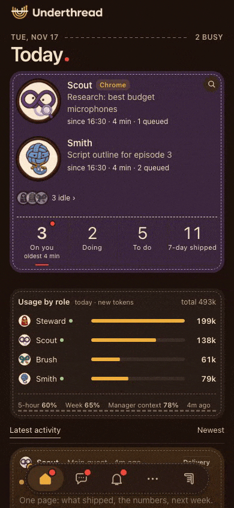
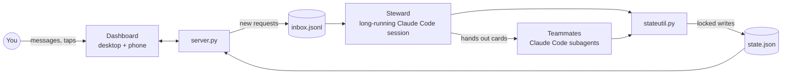

<div align="center">

<picture>
  <source media="(prefers-color-scheme: dark)" srcset="web/brand/wordmark-on-dark@2x.png">
  
</picture>

### A small crew of AI agents that works while you sleep.
#### You just say yes, no, or "try again".


[**Try it in 5 minutes**](#try-it-in-5-minutes) · [**Meet the crew**](#meet-the-crew) · [**A day with your crew**](#a-day-with-your-crew)

[](LICENSE)


</div>

<p align="center"></p>

You know the feeling: twelve things in flight, half of them living only in your head. Underthread gives them somewhere to go.

You talk to one **steward**. The steward turns what you said into cards, hands each card to the right teammate, and comes back when something needs you. Most days, what needs you is a single tap. Everything runs on your own machine, and nothing goes out into the world unless you send it yourself.

> **Early days.** The whole loop works end to end on one machine, and there are still rough edges. If you hit one, an issue is very welcome.

---

## Meet the crew

The repository comes with a ready-made team of seven. Each one has an embroidered patch, and when they're busy they pick up a little tool of their own.

| | Who | What they do |
|---|---|---|
|  | **Steward** | Reads every message you send, sorts it into cards, hands them out and writes you a report at six. Rings a tiny bell when there's work. |
|  | **Scout** | Finds topics, digs up sources and fact-checks the rest of the crew. Never goes anywhere without a magnifying glass. |
|  | **Quill** | Owns every word: outlines, scripts, hooks, titles. Turns a page in a little notebook while thinking. |
|  | **Lens** | Storyboards, shot lists and edit plans. Snaps a clapperboard when a scene is ready. |
|  | **Brush** | Covers and concept art through your own ComfyUI machine. Leaves a dab of paint behind. |
|  | **Signal** | Packaging, the posting calendar, comment-reply drafts and the numbers afterwards. Flies paper planes. |
|  | **Smith** | Keeps the dashboard and the tools running, and makes a backup before touching anything. Knits when nothing is on fire. |

Don't need a content team? Names, duties, tone and the number of teammates all live in `roster.json`. See [Make it your crew](#make-it-your-crew).

---

## A day with your crew

Here's what using Underthread actually looks like.

<p align="center"></p>

**08:55 · Coffee first.** You open the dashboard on your phone. If nothing needs you, the home says so in one line, *Nothing waiting on you*, and you can go back to your coffee. On the desktop, the home is a board of small widgets: what's waiting on you, who's working now, new replies, what shipped today, this week's progress, daily jobs and recent media.

**09:10 · Just say it.** You type a sentence into the chat, the way you'd text a colleague. The steward answers, a new card appears, and a teammate's patch lights up as they get to work. You don't fill in a form or pick a template.

<p align="center"></p>

**10:00 · The routines run themselves.** Jobs you want done every day start at their set time. The routines page shows them as a schedule with a week of past runs, so you can see at a glance which day one was missed. You can pause one with a switch, and a restart never makes it fire twice.

**10:40 · A question, not a wall of text.** Nobody on the crew will hide a decision on page four of a draft. Scout found three tools worth comparing and wants to know which matters more, price or privacy. You get two buttons, and the one Scout would pick is marked and goes first. Got a better idea? "Other…" is always there. Tap, and the card folds itself away while Scout gets back to it.

<p align="center"></p>

**11:30 · Something big?** Anything long or risky starts as a plan. Your teammate tells you what they're about to do, and nothing happens until you say go.

**14:20 · Reviewing, the easy way.** A draft is ready. Every delivery keeps the earlier ones, so you can put v1 and v2 side by side and see exactly what changed. Happy? Accept it, and the crew gets a small "mission complete" moment.

<p align="center"></p>

**15:05 · "Not like that."** You reject a draft and write one line about why. The steward turns that line into a rule proposal for the teammate who wrote it. Confirm it, and they'll read it before every job from then on. Over time the crew stops making the same mistake twice.

<p align="center"></p>

**18:00 · The day in one page.** The steward writes a daily report: what's waiting on you, what shipped, what's still in progress, which rules were adopted, and anything that went wrong.

**23:00 · Quiet hours.** Push notifications go quiet for the night, and a short digest is waiting for you in the morning. The crew keeps working.

---

## Try it in 5 minutes

You'll need macOS or Linux, Python 3.10 or newer (standard library only, nothing to `pip install`) and [Claude Code](https://docs.claude.com/en/docs/claude-code).

```bash
git clone https://github.com/dxu2/underthread.git && cd underthread

# 1. Start the dashboard. The first run makes your own config, roster and state from the examples.
python3 server.py              # then open http://127.0.0.1:8765

# 2. Make the crew yours: edit roster.json, then turn it into agents.
python3 make_agents.py

# 3. Optional: let the crew run their own helper commands without asking you each time.
cp claude-settings.example.json .claude/settings.json

# 4. In a second terminal, wake up the steward.
claude "Start the manager per manager.md"
```

That's it. Say hello in the dashboard's chat. [SETUP-GUIDE.md](SETUP-GUIDE.md) has the long version: roles, restarts and optional tools.

> **Tinkering with the dashboard?** Run a spare copy first with `PORT=8799 NO_LOOPS=1 python3 server.py`, so your real cards stay out of harm's way.

---

## Things you'll grow to like

- **On your phone, too.** Add the dashboard to your home screen and it runs like an app, with a floating tab bar (long-press an icon to see its name), pull to refresh and optional push notifications.

  <p align="center"></p>

- **Push that knows when to shut up.** Each device can get only decisions, decisions plus replies, or everything. Quiet hours run from 23:00 to 09:00 by default, with a morning digest.
- **⌘K, or just `/`.** Search every card and everything said in chat, or jump straight to an action.
- **One mailbox.** Replies, deliveries and notices in one list, with Unread, Replies, Updates and Urgent filters.
- **Your look.** The Underthread palette in coffee and cream, or Ink if you prefer black glass. Night, day, or follow your system. Add a texture on top: Stitch, Sweater, Leather or Saddle.

  <p align="center"></p>

- **Four homes.** Widgets, Dense, App or Classic, picked per computer.
- **Save the good stuff.** On your phone you can save any image from a card at full size, not the thumbnail.
- **Easy on your battery.** After 20 seconds without input, looping animations pause. There's a switch in Settings if you'd rather keep them going.
- **Chinese or English.** Switch the interface language in Settings.

**Little things you might not notice:**
- The opening needle plays once per session. Tap or press any key to skip it, or turn it off in Settings.
- When a teammate is working, their patch picks up their tool: a bell, a magnifying glass, a notebook, a clapperboard, a brush, a paper plane, knitting needles.
- Links in a card are clickable even right after Chinese punctuation.
- Old finished cards quietly move to an archive so the dashboard stays quick, and search still finds them.

---

## Make it your crew

Underthread itself doesn't care what kind of work you do. The steward, cards, reviews, rules and dashboard work the same for any team.

What ships here is one **example preset: a content-creator team** (Bilibili, YouTube, Xiaohongshu), so you can watch a full crew at work straight away. To build a different team:

1. Rewrite the role notes in `roles/*.md`.
2. Rename, add or remove teammates in `roster.json`.
3. Adjust `policy.md` and `config.json`.
4. Run `python3 make_agents.py` again.

No code changes needed. To give a teammate a new face, replace their PNG in `avatars/ut/` and run `python3 tools/avatar_sizes.py` (it needs `cwebp`).

---

## What it promises

1. **Drafts only.** The crew never publishes, posts, uploads, comments or sends anything to the outside world. You do that.
2. **Ask before anything big.** Long or risky work starts as a plan and waits for your go.
3. **Hands off your files.** Teammates write new files in their own work folder. They don't delete or overwrite your uploads, and they back up code and config before editing.
4. **Your data stays home.** Cards, chats, uploads, logs and memories are files in the project folder, all ignored by git. The dashboard only listens on `127.0.0.1`. If you want it on your phone, you expose it yourself, for example over a private network such as Tailscale Serve (push needs https).
5. **Straight answers.** Every delivery says how sure the teammate is and what they didn't check.

Secrets such as the push keys and the optional GitHub token are created on your machine with mode 600 and never sent to the page. Token usage numbers are read from Claude Code's own transcripts on this machine and stay here.

---

## How it's built

<details>
<summary>The short version, for the curious</summary>

<br>



- **One state file.** Everything lives in `state.json`, and only `stateutil.py` writes to it, under a file lock, so the server, the steward and every teammate can write at once without stepping on each other.
- **One inbox.** What you type lands in `inbox.jsonl`. The steward watches it and acts on each entry.
- **A crew from a roster.** `make_agents.py` turns each entry in `roster.json` into a Claude Code subagent with its own role notes, rules and memory folder.
- **No build step.** The dashboard is plain HTML, CSS and JavaScript, served by a standard-library Python server.

Handy tools in `tools/`:

| Tool | What it does |
|---|---|
| `keepalive.sh` | Runs the dashboard and restarts it if it exits |
| `install_service.sh` | Installs the dashboard as a macOS LaunchAgent |
| `ensure_server.py` | Starts the dashboard if it isn't answering |
| `statusline.py` | Feeds your Claude plan usage into the dashboard |
| `avatar_sizes.py` | Makes the small avatar copies the lists use |
| `comfy.py` | Optional: image generation on your own ComfyUI machine |
| `transcribe.py` | Optional: voice memo transcription with whisper.cpp |
| `ghcred.py` | Optional: store a GitHub push token once |

</details>

---

## Not here (yet)

| | |
|---|---|
| Your data | `config.json`, `roster.json`, `state.json`, `archive.json`, `inbox.jsonl`, `uploads/`, `work/`, `logs/` and your own avatars stay on your machine |
| Keys | Push keys and tokens are created locally. Never commit them |
| Models | No whisper, ComfyUI or other model weights. Each keeps its own licence |
| Voice | The author's own build can hold voice calls with the steward. That code isn't in this repository |

Ideas being explored, not promises:
- Teammates handing work to each other when one card depends on another.
- Memories you can edit from the dashboard, not only read.
- Approvals with a scope: "yes for this card", "yes for this kind of change".
- Packaging the whole setup as a Claude Code plugin.

---

## License and changes

Code is [MIT](LICENSE). It covers this repository's code; any models, fonts, voices and images you plug in keep their own licences. The bundled fonts (Nunito, Cinzel) are under the SIL Open Font License 1.1, with licence texts in `web/fonts/`. The Underthread logo, patch avatars and textures were made for this project and contain no third-party artwork.

What changed and when: [CHANGELOG.md](CHANGELOG.md).

<p align="center"><sub>Built by one person and a crew that never sleeps. Issues and ideas welcome.</sub></p>
