<div align="center">

<picture>
  <source media="(prefers-color-scheme: dark)" srcset="web/brand/wordmark-on-dark@2x.png">
  
</picture>

### Your AI crew, stitched into one inbox.
#### You just say yes, no, or "try again".

**English** · [简体中文](README.zh-CN.md)


[**Try it in 5 minutes**](#try-it-in-5-minutes) · [**Meet the crew**](#meet-the-crew) · [**Features**](#features) · [**Phone**](#on-your-phone) · [**Docs**](#docs)

[](LICENSE)


</div>

**What it is.** Underthread is a local dashboard plus a small team of [Claude Code](https://docs.claude.com/en/docs/claude-code) agents. One long-running Claude Code session, the **steward**, reads what you type in the dashboard, turns it into cards, and hands each card to a specialist subagent. The specialists bring back drafts, plans and files. You approve, reject with a reason, or answer a question with one tap.

**Who it's for.** People who already use Claude Code and have more small projects in flight than they can keep in their head: research, writing, planning, small tooling fixes, recurring chores. If you'd rather review a queue than babysit a chat window, it's for you.

**What it costs.** The software is free (MIT). The work is done by Claude Code, so it **uses your own Claude plan's usage**, and the steward stays online all day. Every card a teammate works on spends plan quota. The steward watches the meter: once usage passes 85% it queues new work instead of dispatching it, and at 95% it sleeps until the usage window resets.

<p align="center">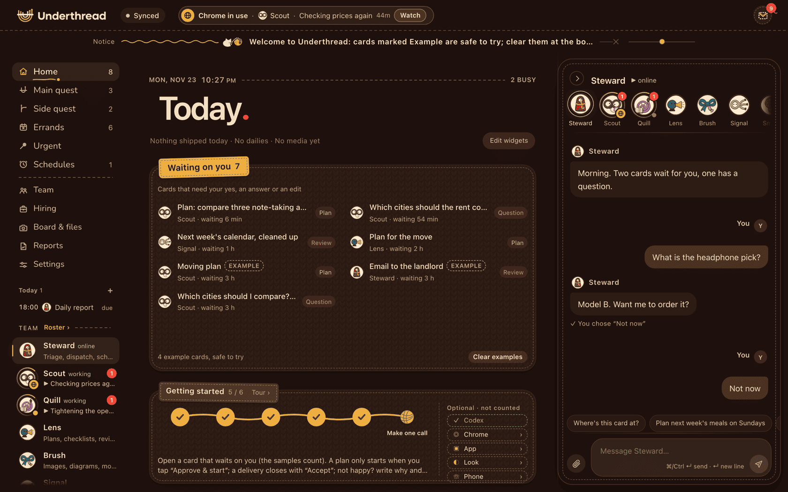</p>

Everything runs on your own machine, and nothing goes out into the world unless you send it yourself.

> **Early days.** The whole loop works end to end on one machine, and there are still rough edges. If you hit one, an issue is very welcome.
>
> Underthread is an independent project. It is **not affiliated with, endorsed by or sponsored by Anthropic**. "Claude" and "Claude Code" are Anthropic's product names.

## Contents

- [Meet the crew](#meet-the-crew)
- [Try it in 5 minutes](#try-it-in-5-minutes)
- [What to say to the steward](#what-to-say-to-the-steward)
- [A day with your crew](#a-day-with-your-crew)
- [Features](#features)
- [On your phone](#on-your-phone)
- [Updating](#updating)
- [Make it your crew](#make-it-your-crew)
- [Extend it without forking](#extend-it-without-forking)
- [What it promises](#what-it-promises)
- [How it works](#how-it-works)
- [Docs](#docs)
- [FAQ](#faq)
- [Contributing and security](#contributing-and-security)
- [Roadmap](#roadmap)
- [License](#license)

---

## Meet the crew

The default crew starts small: five members, and you hire the rest as you need them. Each one has an embroidered patch, and when they're busy they pick up a little tool of their own.

> **Steward = manager.** In files, commands and the roster, the steward's id is `manager` (`manager.md`, `set-agent manager`). The other ids are in the third column.

| | Who | Id | What they do |
|---|---|---|---|
|  | **Steward** | `manager` | Reads every message you send, sorts it into cards, hands them out and writes you a daily report. Rings a tiny bell when there's work. |
| 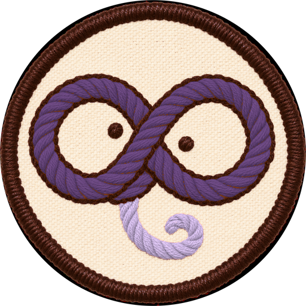 | **Scout** | `scout` | Research, comparisons and fact-checks, with a source for every claim. Never goes anywhere without a magnifying glass. |
| 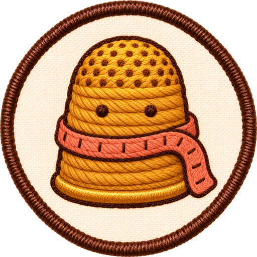 | **Thimble** | `hr` | Hires the rest of the crew: interviews you about the job you need filled (five things, a few turns), then writes the new teammate's notes for your OK. Also handles transfers. |
| 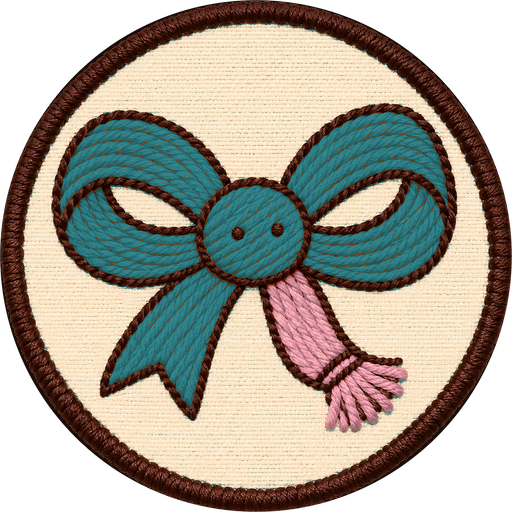 | **Brush** | `artist` | Images, diagrams and mockups, through Codex on your ChatGPT plan (see [Pictures](#pictures-codex-or-none)). Leaves a dab of paint behind. |
|  | **Smith** | `smith` | Keeps the dashboard and the tools running, and makes a backup before touching anything. Knits when nothing is on fire. |

Short on someone? Open the Hiring market (29 job templates): Thimble interviews you about five things, the new teammate starts work, and Brush stitches them a patch of their own. Names, duties, tone and the number of teammates all live in `roster.json`. See [Make it your crew](#make-it-your-crew).

---

## Try it in 5 minutes

**The 60-second version**, for people who already have Claude Code signed in:

```bash
git clone https://github.com/dxu2/underthread.git && cd underthread
./start
```

That's it: `./start` starts the dashboard, opens it in your browser and wakes the steward in the same terminal. On a Mac it also offers to put an **Underthread icon** in Applications, so next time you just click it. Then type a request into the dashboard's chat. Just looking? `./start --demo` needs no Claude Code at all. The rest of this section is the same thing, slowly, with what you should see at each step.

### What you need

| Need | Why |
|---|---|
| macOS or Linux | Windows is untested |
| Python 3.10 or newer | Standard library only, nothing to `pip install` |
| A browser from 2023 or later | The page is ES modules with an import map: Safari / iOS 16.4+, Chrome / Edge 89+, Firefox 108+ |
| [Claude Code](https://docs.claude.com/en/docs/claude-code), signed in to a paid Claude plan | Every teammate is a Claude Code subagent, and the work uses your plan's usage |
| A Claude Code version with the **Monitor** tool | The steward watches `inbox.jsonl` with a background Monitor. Without it, nothing you type in the dashboard gets picked up |
| A usage feed (optional, either one) | In a terminal, Claude Code's `statusLine` runs `tools/statusline.py` (Pro or Max plan). In the Claude desktop app, the steward calls the app's usage tool. Without either, the usage widget says "no usage data" and the 85% / 95% brakes can't kick in |

### Steps

**1. Get it and start it.**

```bash
git clone https://github.com/dxu2/underthread.git && cd underthread
./start
```

`./start` does the setup in order and prints one line per step:
- checks for Python 3.10+ (and says which version to install if yours is older), git and the `claude` command;
- starts the dashboard in the background, or reuses it if it is already running. The first run copies `config.example.json`, `roster.example.json` and `state.example.json` to `config.json`, `roster.json` and `state.json`;
- creates one Claude Code subagent per teammate in `.claude/agents/` (`make_agents.py`), and again whenever `roster.json` is newer;
- opens <http://127.0.0.1:8765> in your browser;
- asks two questions, once each (your answers are kept in `local/start.json`): **an Underthread icon?** (default yes) and, on macOS, **start the dashboard when you log in?** (default no; yes runs `tools/install_service.sh`, which adds a login item);
- wakes the steward: this terminal becomes the steward's window. Leave it open. If a steward is already running, it says so and doesn't start a second one.

The first time, Claude Code asks you to sign in and to trust this folder. The repository ships `.claude/settings.json`, which lets the crew run their own helper commands without asking you each time and feeds your usage to the dashboard. Leave it as it is, and put any permissions of your own in `.claude/settings.local.json` (git ignores it, and Claude Code reads both).
*You should see:* the home page with a few example cards. Within a few seconds the steward's status in the header turns to online and a hello appears in the chat.

**2. Say something.** Type a request into the chat, the way you'd text a colleague.
*You should see:* a new card appears, and a teammate's patch lights up as they start on it.

**Next time,** click the **Underthread** icon (in Applications on a Mac, drag it to the Dock if you like; in your app menu on Linux). It starts or reuses the dashboard, opens it, and, if the steward isn't running, wakes it in a Terminal window that tucks itself into the Dock. The first click asks once whether Underthread may control Terminal (that is what minimises the window; say no and the window simply stays open). Closing that window takes the steward offline; click the icon again to bring it back. Or just run `./start` again.

> **About the icon.** `./start` makes it on your own Mac with the system's tools (`osacompile`, `sips`, `iconutil`), so macOS opens it without a Gatekeeper warning. Don't copy the app to another Mac: run `./start` there instead. If you move the folder, the icon tells you to run `./start` once in the new place, which makes it again. `./start --app` remakes it any time.

> **Uninstall.** `./start --uninstall` takes Underthread off this computer in one go: the login item (if you added one), the running dashboard and steward, and the icon, only the ones that belong to this folder. It shows the list and asks once (default no); `./start --uninstall --dry-run` only shows the list. Then it asks separately, each defaulting to keep, whether to delete the whole folder (your cards, `local/`, `work/`, `uploads/`; a backup zip goes to `~/UnderthreadBackups/` first) and Claude Code's session logs for this folder (`~/.claude/projects/…`). It never touches Claude Code itself, its settings, other projects or the Claude desktop app.

> **Just looking?** Run `./start --demo` (or `python3 server.py --demo`). You get the dashboard with a crew at work and no Claude Code needed: the steward opens cards, teammates light up, log progress and hand in drafts, and whatever you click gets a short canned reply. The demo runs from its own `.demo/` folder, rebuilt on every start, so your real cards are never read or written. Stop it with Ctrl-C. `PORT=8766` picks another port; `--lang zh` or `--lang en` sets the chat language (default: from `$LANG`).

**Running the steward in the Claude desktop app instead?** Use `./start --no-steward`, then open this folder in the app and say `Start the manager per manager.md`. **Prefer to do every step by hand** (`python3 server.py`, `python3 make_agents.py`, `claude "Start the manager per manager.md"`)? That still works exactly as before; see [docs/setup-guide.md](docs/setup-guide.md).

The **Getting started** checklist on the home page walks you through these steps and ticks each one by itself. It goes away the day after the last tick (Edit widgets brings it back). Before that, a new board opens with five short welcome pages and a three-step tour of the page; Settings → General → Replay shows them again.

---

## What to say to the steward

Plain sentences work. These are the usual kinds of request; the same list sits above the chat field (tap one to fill the field, nothing is sent until you press send), and **All phrases** opens it in full.

| You want to | Say something like | Who takes it | What comes back |
|---|---|---|---|
| Ask where things are | "Where's the “X” card at?" · "Who's busy right now?" | Steward | an answer in the chat, no new card |
| Set up a schedule | "Every Sunday night, plan next week's meals" · "A morning brief at 8 every day" | Steward | a schedule; the card stays on Schedules and each run reports back to it |
| Look something up | "Search Xiaohongshu for reviews of X, give me three points" · "Compare rents in these three cities" | Scout | a research card: every point has a link and a screenshot |
| Shop | "Any X worth buying?" · "Put the best one in my cart, don't order" | Buyer (hire from the Hiring market) | 3 options with price history; it always asks before ordering |
| Plan a trip | "A quiet 3-day trip for the holiday" · "Plan a week for family visiting" | Travel planner (hire) | three plans, a budget and a packing list; it never books |
| Write something | "Reply to this email, politely" · "Turn these notes into one page" | Steward, or a writer once you hire one | a draft card that ships when you approve it |
| Make images | "Three cover ideas for X" · "Make this image portrait" | Brush | a sample card with a few images to pick from |
| Fix a tool or the dashboard | "A script to file my downloads by date" · "This button does nothing, is it a bug?" | Smith | a plan first, a backup before any change |
| Hire or wrap up | "I want someone to handle X" · "Going to bed, finish what you can" | Thimble / Steward | an interview in a DM, or the next morning's report |

When a card comes back: reject it with a reason ("too long, keep it under 300 words from now on" becomes a rule), tap an option to answer a question, or ask for a tweak in a comment.

Something not working? See [Troubleshooting](docs/troubleshooting.md). The long version of setup is in [docs/setup-guide.md](docs/setup-guide.md).

---

## A day with your crew

The screenshots below are a sample board (the `classic` seven-person crew, made-up cards), in the Stitch look.

**09:10 · Just say it.** You type a sentence into the chat. The steward answers, a new card appears, and a teammate gets to work. No form, no template. The **Working now** row shows who is on what, and a small knit kitten keeps them company while they work (it curls up and naps at night).

**10:40 · A question, not a wall of text.** Nobody hides a decision on page four of a draft. Scout wrote a plan and wants to know one thing first. You get the options as buttons, the one Scout would pick goes first (marked Rec.), and "Other…" is always there.

<p align="center">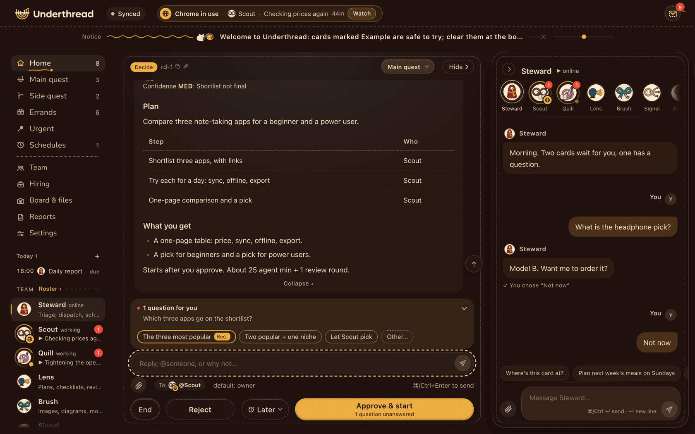</p>

**11:30 · Something big?** Anything long or risky starts as a plan. Nothing happens until you press **Approve & start**; the first time a plan waits on you, a one-time bubble says so.

**14:20 · Reviewing, the easy way.** Every delivery keeps the earlier ones, so you can put v1 and v2 side by side and see exactly what changed. Happy? **Accept & close**, and a short "mission complete" plays.

**15:05 · "Not like that."** You reject a draft and write one line about why. The steward turns that line into a rule proposal for the teammate who wrote it. Confirm it, and they read it before every job from then on.

**18:00 · The day in one page.** The steward writes a daily report: what's waiting on you, what shipped, what's still in progress, which rules were adopted, anything that went wrong.

---

## Features

### The desk

- **A home you arrange.** The desktop home is a set of widgets: Waiting on you (always first), Working now, New replies, Shipped today, This week, Dailies, Recent media, usage and more. In **Edit widgets**, drag them around and give each one a size: S (a number), M or L (more rows, a chart, a 3 × 3 of recent images). Each board wears a small sewn-on label; when something new lands on it, the label is tugged once and a stitch of light runs around the edge.
- **Getting started checklist.** A new board shows a six-step yarn-ball checklist (dashboard up, team in place, steward awake, first message, first card, first decision), plus optional steps (Codex, Chrome, the app icon, a look, your phone). Each step ticks itself; the checklist folds away the day after the last tick. Before that, five welcome pages and a three-step tour introduce the page (Settings → General → Replay shows them again).
- **Cards side by side.** The quest pages (All, Main quest, Side quest, Errands, Urgent) show up to three columns of cards. A card with an image wears it as a cover, and its question can be answered right there.

  <p align="center">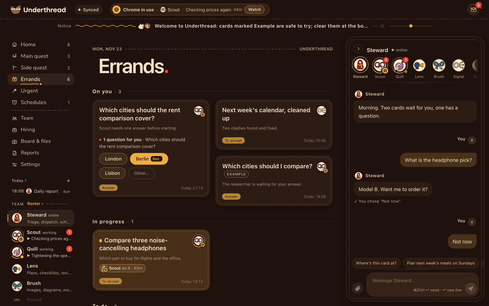</p>

- **Cards and review.** Every piece of work is a card with a category, an owner, a stage (to do, doing, review, done), a thread and versioned drafts. A card someone is working on shows a **Working** band: who, for how long, their latest step. Images show inline, video plays in place, and links are clickable.
- **Questions with a tap.** Agents attach two to four options to a card, with their pick first. Your answer is quoted in the thread so it still reads well later.
- **Rules that grow.** A rejection reason becomes a one-line rule proposal; confirmed rules live in each role's notes and override its defaults.
- **Chat, DMs and one mailbox.** The steward chat sits on the right, with quick phrases above the field. Each teammate has a DM. The mailbox collects replies, deliveries and notices, with filters (All, Unread, Replies, Updates, Urgent).
- **Notices.** A Notice line under the top bar carries the latest news (a little kitten nudges the yarn when something new arrives; at night the line goes quiet). When a card is handed in for review, the board blurs behind the teammate's avatar for a moment, at most every 20 minutes and never at night or while you type; every other notice drops in as one pill at the top centre.
- **Schedules in one sentence.** "Remind me tomorrow at 9" or "every weekday at 9, ask Scout for trends" becomes a schedule with an on/off switch and a week of run history.

  <p align="center">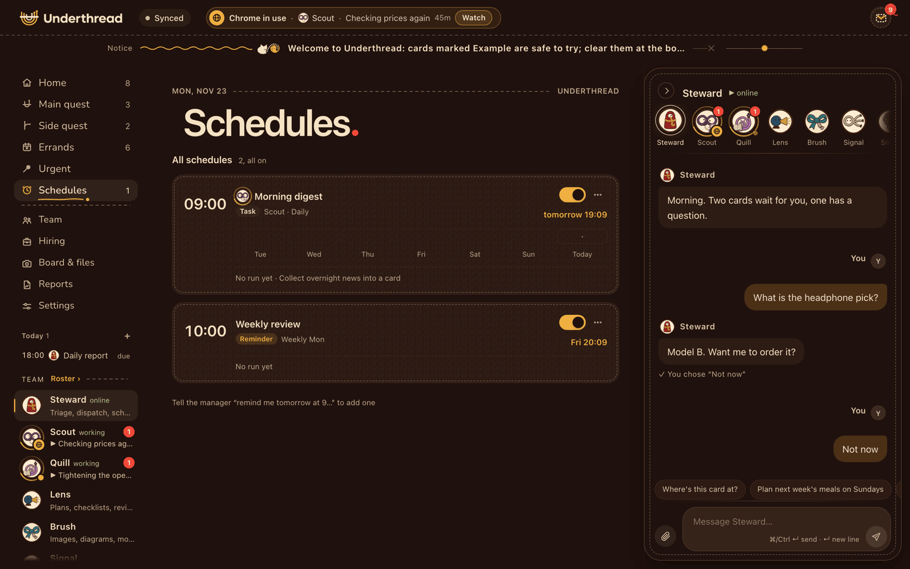</p>

- **Team page.** Every teammate as a card: status, their cards, memory and notes, plus DM, Rename, Avatar, Transfer and Retire.

  <p align="center">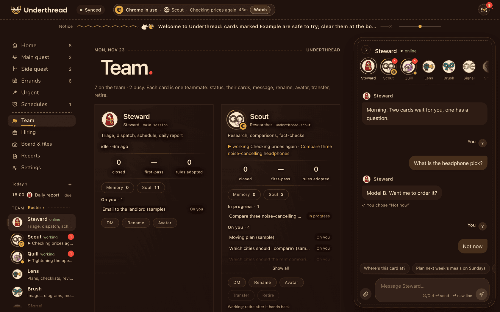</p>

- **Watch.** While a teammate drives Chrome, a **Watch** button on its pill shows the last screenshot it took and follows new ones. Frames stay in `.live/` on this computer and are never uploaded; Settings → Connections turns it off.
- **Your mail in the steward's inbox (optional).** Connect Gmail in Settings → Connections (app password, stored in the keychain) and new mail arrives as one headers-only entry every few minutes, sorted into "needs you / can draft / FYI". Read-only: nothing is ever sent or deleted. See [Feeds](docs/feeds.md).
- **⌘K, or just `/`.** Search every card, draft and everything said in chat, and run actions such as approving a card.
- **Usage.** Today's tokens per role (read from Claude Code's own transcripts on this machine) and how much of your plan window is left.
- **Archive.** Old finished cards move out of the way so the dashboard stays quick; search still finds them.

### Looks

Four looks, each in night and day (or follow the system): **Stitch** (knit texture, the signature look), **Ink** (black glass), **Leather** and **Plain**. Pick one in the checklist's Look step or in Settings → Appearance. A new browser starts on Leather.

<p align="center">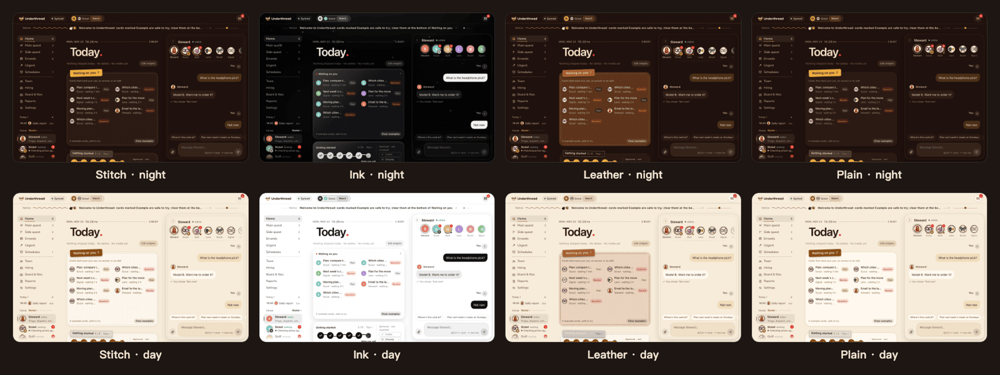</p>

Every button, tab and switch responds to hover, press and switch, and everything respects reduced motion. Looping animations pause after 20 seconds without input or when the window is in the background (power saving, on by default).

### Languages

English or Chinese interface, switchable in Settings (Settings → General). The steward and the crew write to you in your language.

---

## On your phone

The same dashboard, laid out for a phone. Add it to your home screen and it runs like an app.

<p align="center">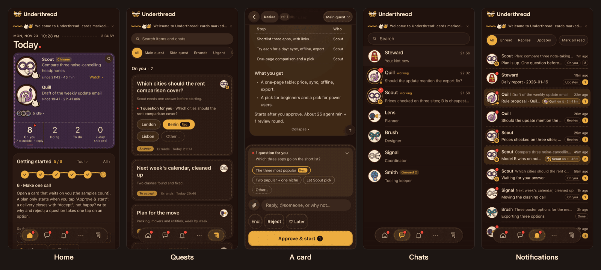</p>

- **Home** opens with a status card: who is working on what, then four tiles (on you, doing, to do, shipped in 7 days). Tap a tile and the page scrolls to that list. Below it: usage, the checklist and the latest activity. Prefer widgets? Settings → General → Phone home → Widgets shows the desk widgets in two columns.
- **A floating tab bar**: Home, Chats, Notifications, More and Quests. The selected tab slides like a glass lens; a long press shows the name.
- **Cards** open full screen with the question panel above the buttons. Pull down anywhere to refresh.
- **Push notifications** (optional): per device, for decisions only, decisions plus replies, or everything, with quiet hours and a morning digest.

**Setting it up.** The dashboard only listens on `127.0.0.1`, so your phone reaches it through a private network. The easiest way is [Tailscale](https://tailscale.com): install it on the computer and the phone, run `tailscale serve --bg 8765`, and open the `https://<machine>.<tailnet>.ts.net` address it prints. Then **Add to Home Screen** (iPhone: from Safari's Share menu; push needs iOS 16.4+ and the home-screen app). The checklist's Phone step shows a QR code for the address. Never put the dashboard on the public internet (no Tailscale Funnel, no port forwarding): it has no login. Full guide: [docs/phone-and-push.md](docs/phone-and-push.md).

---

## Updating

Settings → System → Updates says when a new version is out; click **Update**, and it is tried on a copy of your data first, then the dashboard restarts on the new version with your cards, settings and `local/` layer as they were. **Go back** returns to the version before. Or from a terminal: `python3 tools/update.py check | apply | rollback` (`apply --dry-run` only tries the new version on a copy). Open pages switch to the new version by themselves the next time you come back to them (or show a "Dashboard updated" pill while you are using them), and if you update with `git pull` instead, Settings → System → Updates offers **Restart** once the server's code has changed on disk. This needs the `git clone` install above: a folder downloaded as a zip cannot update itself (clone again and copy `local/` and your `*.json` data files over).

> **Tinkering with the dashboard?** Run a spare copy from a copied folder with `PORT=8799 NO_LOOPS=1 python3 server.py`, so your real cards stay out of harm's way.

---

## Make it your crew

Underthread itself doesn't care what kind of work you do. The steward, cards, reviews, rules and dashboard work the same for any team. Ways to change the crew:

1. **Hiring market** (in the left rail). Pick a template and click **Interview**: HR asks you a few questions, writes the new teammate's notes, and they start once you approve. **Hire** skips the interview. Either way the newcomer gets an avatar, a role note and an agent file. A crew without HR gets a **Hire HR first** button.
2. **Command line.** `python3 tools/new_role.py plan|apply|retire|rehire|update`.
3. **By hand.** Edit `roster.json` and `local/roles/<id>.md`, then run `python3 make_agents.py`.
4. **A whole team at once.** The strip at the top of the market swaps in a preset crew: `classic` (an earlier seven-person team with a writer, a planner and a coordinator) or `content-zh` (a Chinese content-creator team). It shows what changes before anything is written, and backs up every file it replaces. `python3 tools/preset.py apply <name>` does the same from the command line.

5. **Content creators.** The Pipeline and Channels pages (a production line and per-platform previews for B站 / YouTube / 小红书) are off on a fresh install. They switch on by themselves with the `content-zh` preset or when `config.json` lists platforms, or by hand in Settings → Pipeline & Channels.

<p align="center">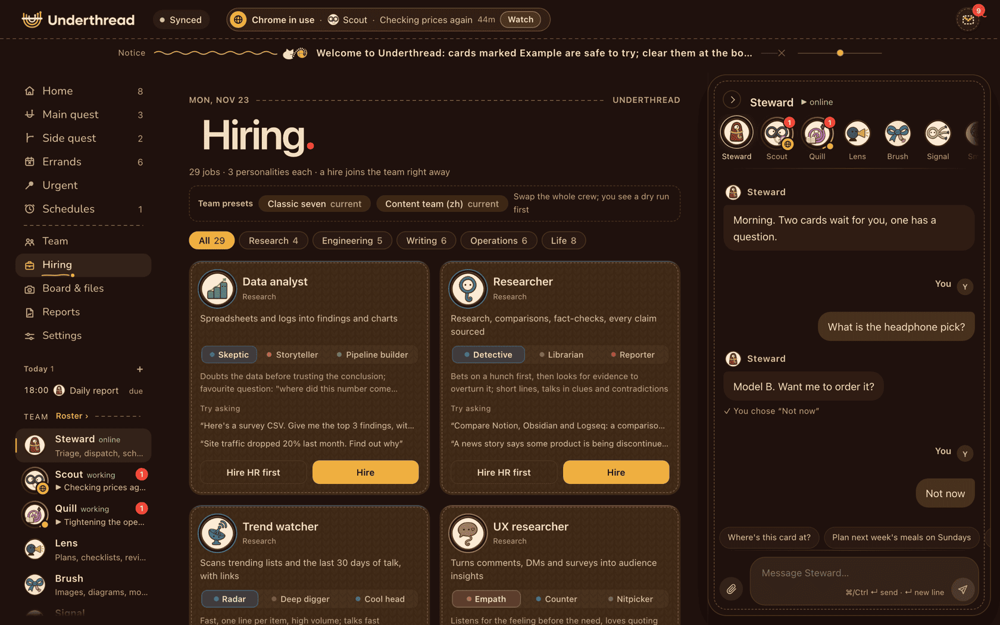</p>

The **Team** page in the left rail is the roster: move a teammate to a new job (**Transfer**), retire them (**Retire**), rename them or pick their avatar. Rename and avatar choices are saved on the role's entry in `roster.json`, which updates never replace.

Full guide, with every roster field and a worked example: [docs/custom-crew.md](docs/custom-crew.md).

### Pictures: codex or none

Brush, avatars for new hires and a few tools draw through `tools/image.py`, which picks a backend from `config.json` → `image.backend`:

| Setting | What it uses |
|---|---|
| `auto` (default) | Codex if it is signed in with ChatGPT, else none |
| `codex` | The Codex CLI (or the one inside ChatGPT.app) on your ChatGPT subscription. Never an API key |
| `none` | No drawing. New hires get their job template's patch instead, and everything else still works |

`python3 tools/image.py backend` tells you which one is active and why. Every picture costs quota, so there are no automatic retries. ComfyUI support was removed in this version; an old `image.backend: "comfy"` is read as `auto`.

---

## Extend it without forking

Everything git tracks is **core**, and an update may replace any core file. Your own changes live in **`local/`**, which git ignores and updates never touch: role notes (`local/roles/<id>.md`), your own manager notes, extra page scripts and styles (`local/web/`), and extensions.

An **extension** (`local/ext/<name>/`) adds a feature without changing a core file: an API endpoint, a button action, a card kind, a scheduled job, a health check, a `stateutil.py` command, a home widget or a tour step. Watch is the first built-in one (`ext/live/`); a `local/ext/` folder with the same name replaces it. See [docs/local.md](docs/local.md) and [docs/extensions.md](docs/extensions.md).

---

## What it promises

1. **Drafts only.** The crew never publishes, posts, uploads, comments or sends anything to the outside world. You do that.
2. **Ask before anything big.** Long or risky work starts as a plan and waits for your go.
3. **Hands off your files.** Teammates write new files in `work/<card-id>/`. They don't delete or overwrite your uploads, and they back up code and config before editing.
4. **Your data stays home.** Cards, chats, uploads, logs and memories are files in the project folder, all ignored by git. The dashboard only listens on `127.0.0.1`. Push keys and tokens are created on your machine with mode 600 and never sent to the page. Usage numbers are read from Claude Code on this machine and stay here.
5. **Straight answers.** Every delivery says how sure the teammate is and what they didn't check.

More in [.github/SECURITY.md](.github/SECURITY.md) and [Contributing and security](#contributing-and-security).

---

## How it works

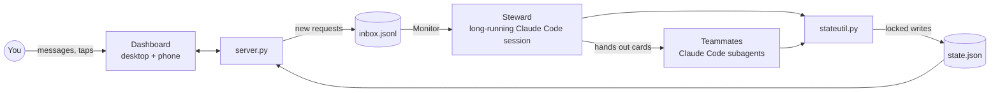

- **One state file.** Everything lives in `state.json`, and only `stateutil.py` writes to it, under a file lock.
- **One inbox.** What you do in the dashboard lands in `inbox.jsonl`. The steward watches it and acts on each entry.
- **A crew from a roster.** `make_agents.py` turns each entry in `roster.json` into a Claude Code subagent.
- **No build step.** Plain HTML, CSS and JavaScript, served by a standard-library Python server.

The full loop, the card lifecycle and where memory lives: [docs/architecture.md](docs/architecture.md).

---

## Docs

| | |
|---|---|
| [docs/setup-guide.md](docs/setup-guide.md) | Full setup: config, roster, permissions, restarts, pictures, tools |
| [docs/layout.md](docs/layout.md) | Folder map: what every file and folder is, which ones are yours |
| [docs/architecture.md](docs/architecture.md) | How the pieces talk, card lifecycle, memory |
| [docs/custom-crew.md](docs/custom-crew.md) | Add, change, transfer or retire teammates; roster fields; presets |
| [docs/phone-and-push.md](docs/phone-and-push.md) | Phone app, Tailscale Serve, push notifications |
| [docs/local.md](docs/local.md) | Your own layer: what goes in `local/` and why updates never touch it |
| [docs/extensions.md](docs/extensions.md) | Writing an extension: endpoints, actions, widgets, jobs |
| [docs/feeds.md](docs/feeds.md) | Connect Gmail: the feed collector, its inbox entries and where the password lives |
| [docs/troubleshooting.md](docs/troubleshooting.md) | Troubleshooting and FAQ |
| [.github/CONTRIBUTING.md](.github/CONTRIBUTING.md) | Working on Underthread itself |
| [.github/SECURITY.md](.github/SECURITY.md) | Threat model and how to report a problem |
| [CHANGELOG.md](CHANGELOG.md) | What changed and when |

---

## FAQ

**Does it work without Claude Code?** Only the demo (`./start --demo`). The real work is done by Claude Code sessions.

**Will it post anything for me?** No. Teammates hand back drafts; you publish.

**Is my data sent anywhere?** Only to Claude Code (and Codex, if you turn pictures on), as part of the work you asked for. The dashboard itself listens on `127.0.0.1` and stores everything as files in the project folder.

**Does it run on Windows?** Untested. macOS and Linux are.

**The steward shows offline.** It is not running, or its Monitor stopped. Run `./start` again (or click the icon). The log is `logs/server.log`.

**I typed in the dashboard and nothing happened.** The steward reads `inbox.jsonl` with a background Monitor; check that it is online and that your Claude Code version has the Monitor tool.

More answers, and fixes for common problems: [docs/troubleshooting.md](docs/troubleshooting.md).

---

## Contributing and security

Issues and pull requests are welcome; [.github/CONTRIBUTING.md](.github/CONTRIBUTING.md) explains the tests (`python3 tests/run.py quick`, browser journeys in `tests/e2e/`) and the rules for changes (every release must upgrade existing installs by itself). Please follow the [Code of Conduct](.github/CODE_OF_CONDUCT.md).

Found a security problem? Don't open a public issue: use GitHub's **Report a vulnerability** button on the repository's Security tab (private vulnerability reporting). Details in [.github/SECURITY.md](.github/SECURITY.md).

---

## Roadmap

Ideas being explored, not promises:
- Teammates handing work to each other when one card depends on another.
- Memories you can edit from the dashboard, not only read.
- Approvals with a scope: "yes for this card", "yes for this kind of change".
- Packaging the whole setup as a Claude Code plugin.

Not in this repository: voice calls with the steward (the author's own build has them), and model weights (whisper and so on keep their own licences).

---

## License

Code is [MIT](LICENSE). Any models, fonts, voices and images you plug in keep their own licences. The bundled fonts (Nunito, Cinzel) are under the SIL Open Font License 1.1, with licence texts in `web/fonts/`. The QR code generator in `web/js/vendor/qrcode.js` is Kazuhiko Arase's, MIT-licensed (from the qrcode-terminal package, Apache-2.0; notices in `web/js/vendor/qrcode.LICENSE.txt`). The Underthread logo, patch avatars, the job-template avatars under `templates/roles/` and the textures under `web/` were made for this project, contain no third-party artwork, and are MIT-licensed like the code.

The name and logo identify this project. If you redistribute a modified fork, please give it a different name.

<p align="center"><sub>Built by one person and a crew that never sleeps. Issues and ideas welcome.</sub></p>
