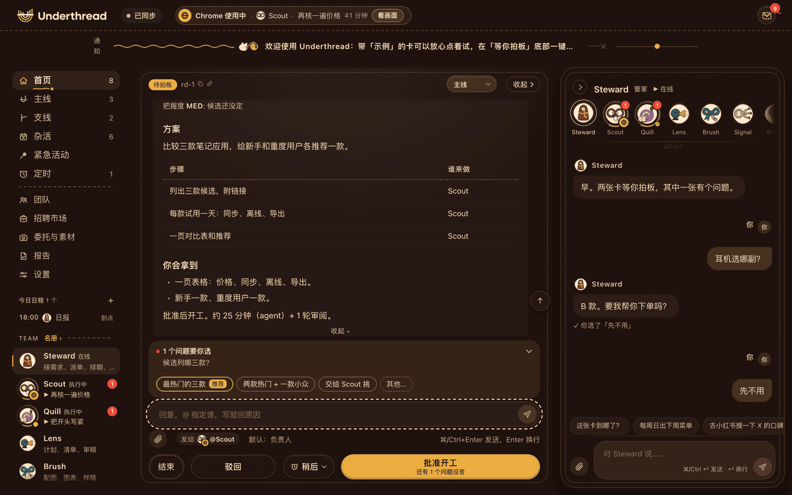
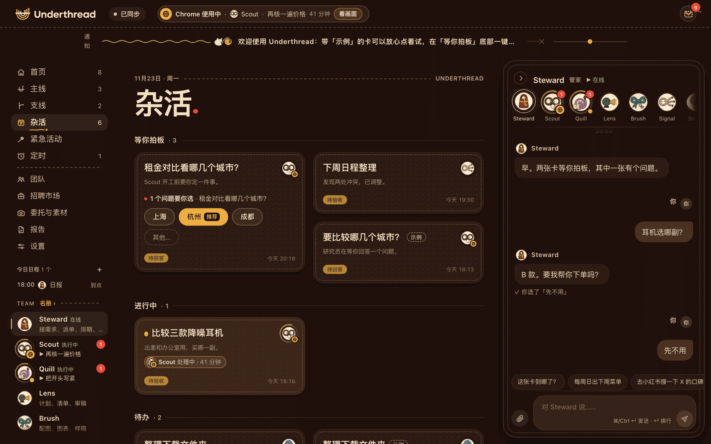
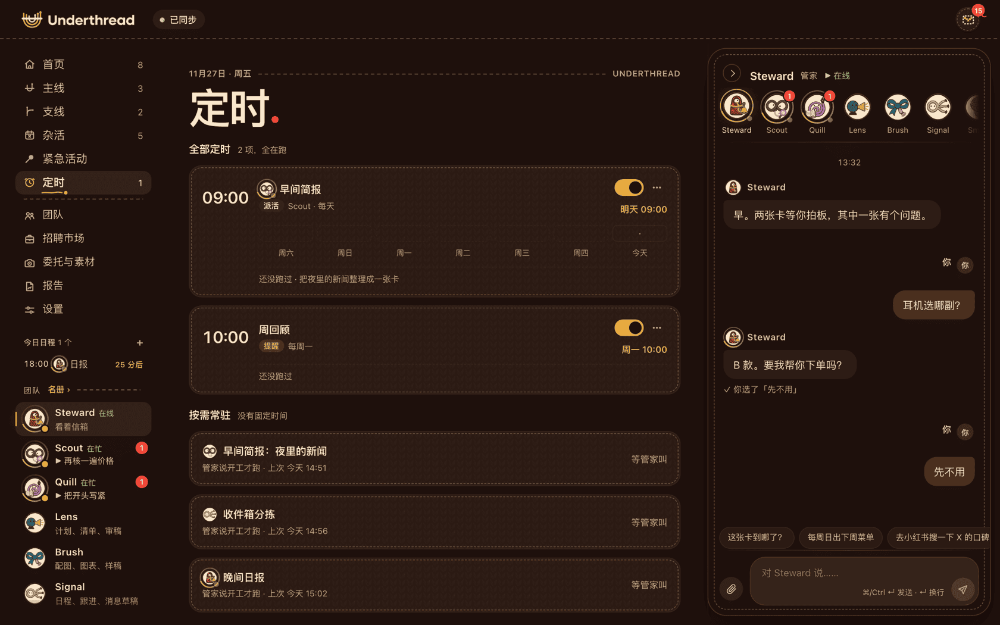
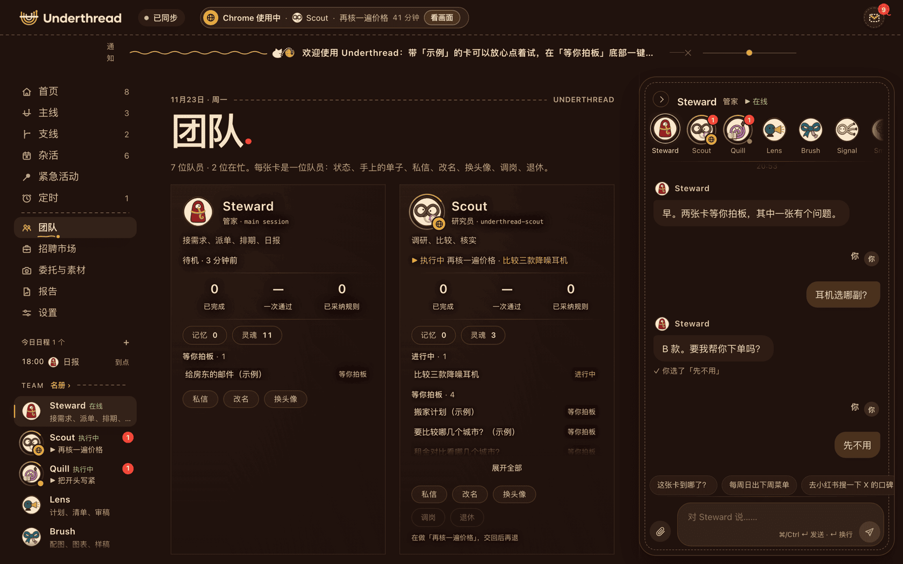
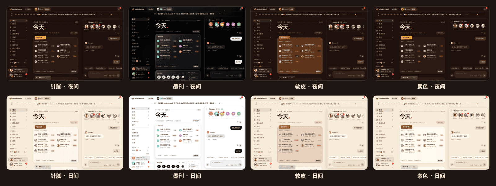
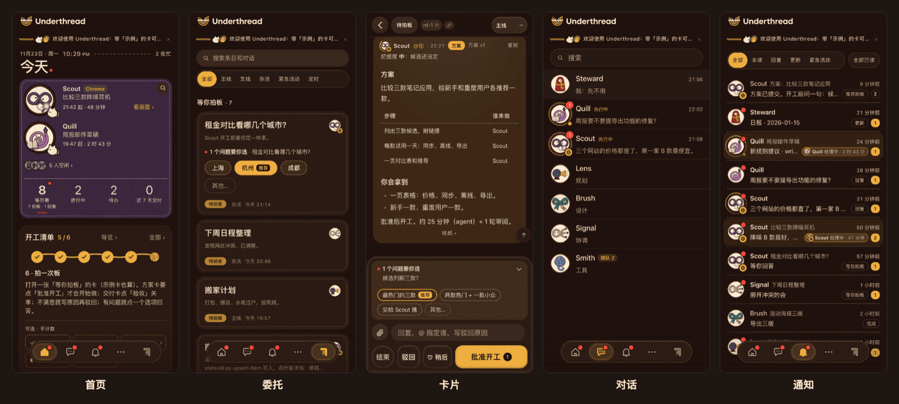
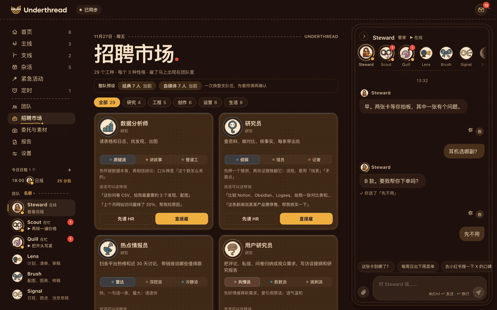
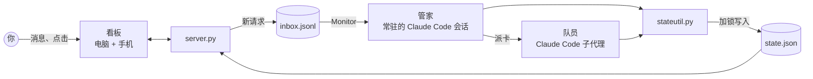

<div align="center">

<picture>
  <source media="(prefers-color-scheme: dark)" srcset="web/brand/wordmark-on-dark@2x.png">
  
</picture>

### 一个管家，一支 AI 小队，你只管点头。
#### 你只需要说：行、不行、再来一版。

[English](README.md) · **简体中文**


[**5 分钟跑起来**](#5-分钟跑起来) · [**认识队员**](#认识队员) · [**功能**](#功能) · [**手机**](#手机上用) · [**文档**](#文档)

[](LICENSE)


</div>

**这是什么。** Underthread 是一个跑在你自己电脑上的看板，加上一支由 [Claude Code](https://docs.claude.com/en/docs/claude-code) 驱动的小队。一个常驻的 Claude Code 会话当**管家**：你在看板里说的话，它整理成卡片，再派给对应的专员（Claude Code 子代理）。专员交回来的是草稿、计划和文件，你来批准、驳回（写一句原因），或者点一下回答它的问题。

**给谁用。** 已经在用 Claude Code、手上同时挂着一堆小事的人：查资料、写东西、做计划、修小工具、每天要做的杂事。比起盯着一个聊天窗口，你更想每天过一遍待审队列，那就适合你。

**要花什么。** 软件本身免费（MIT）。活是 Claude Code 干的，所以**会用掉你自己 Claude 订阅的额度**，而且管家全天在线，每张卡都要消耗额度。管家会看着用量：超过 85% 只排队不派新活，到 95% 就睡到额度窗口重置。

<p align="center"></p>

所有东西都在你自己的机器上。你不亲手发出去的东西，什么都不会出去。

> **还在早期。** 整个流程在一台机器上已经能从头跑到尾，但还有毛边。碰到问题欢迎开 issue。
>
> Underthread 是独立项目，**与 Anthropic 没有任何关联，也未获其认可或赞助**。Claude 和 Claude Code 是 Anthropic 的产品名。

## 目录

- [认识队员](#认识队员)
- [5 分钟跑起来](#5-分钟跑起来)
- [跟管家怎么说](#跟管家怎么说)
- [和小队过一天](#和小队过一天)
- [功能](#功能)
- [手机上用](#手机上用)
- [升级](#升级)
- [组建你自己的小队](#组建你自己的小队)
- [不改核心也能扩展](#不改核心也能扩展)
- [我们的承诺](#我们的承诺)
- [怎么运转的](#怎么运转的)
- [文档](#文档)
- [常见问题](#常见问题)
- [参与和安全](#参与和安全)
- [路线图](#路线图)
- [许可](#许可)

---

## 认识队员

默认小队从五个人起步，缺谁再招谁。每人一枚刺绣徽章，干活的时候会拿起自己的小工具。

> **管家 = manager。** 文件、命令和 roster 里，管家的 id 是 `manager`（`manager.md`、`set-agent manager`）。其他人的 id 见第三列。

| | 谁 | Id | 做什么 |
|---|---|---|---|
|  | **Steward**（管家） | `manager` | 读你发的每条消息，整理成卡片、派出去，每天给你写日报。有活的时候摇一下小铃铛。 |
|  | **Scout**（研究员） | `scout` | 查资料、做对比、核事实，每条结论都带出处。放大镜不离手。 |
|  | **Thimble**（HR） | `hr` | 帮你招其余的人：就你想招的岗位问你五件事（几轮就完），写好新人的角色笔记等你批准。调岗也找她。 |
|  | **Brush**（设计） | `artist` | 图片、示意图和样稿，走 ChatGPT 订阅里的 Codex（见[出图](#出图codex-或不出图)）。走过留下一点颜料。 |
|  | **Smith**（工具） | `smith` | 维护看板和工具，动手前先备份。没事的时候织毛线。 |

缺人？去招聘市场（29 个岗位模板）：Thimble 问你五件事，新人就上岗，Brush 还会给他缝一枚自己的补丁头像。名字、职责、语气、人数都在 `roster.json` 里。见[组建你自己的小队](#组建你自己的小队)。

---

## 5 分钟跑起来

**60 秒版**，适合已经登录好 Claude Code 的人：

```bash
git clone https://github.com/dxu2/underthread.git && cd underthread
./start
```

就这些：`./start` 会起看板、在浏览器里打开、在同一个终端里叫醒管家。在 Mac 上它还会问要不要在「应用程序」里放一个 **Underthread 图标**，以后点一下就行。然后在看板的聊天框里说一句话。只想看看？`./start --demo` 完全不需要 Claude Code。下面是同样的步骤，慢慢讲，每一步都写了你应该看到什么。

### 需要什么

| 需要 | 为什么 |
|---|---|
| macOS 或 Linux | Windows 没测过 |
| Python 3.10 以上 | 只用标准库，不用 `pip install` |
| 2023 年以后的浏览器 | 页面是 ES module + import map：Safari / iOS 16.4+、Chrome / Edge 89+、Firefox 108+ |
| [Claude Code](https://docs.claude.com/en/docs/claude-code)，登录付费的 Claude 订阅 | 每个队员都是 Claude Code 子代理，干活用的是你的订阅额度 |
| 带 **Monitor** 工具的 Claude Code 版本 | 管家靠后台 Monitor 盯着 `inbox.jsonl`。没有它，你在看板里说的话没人接 |
| 用量来源（可选，二选一） | 终端里：Claude Code 的 `statusLine` 跑 `tools/statusline.py`（Pro 或 Max 订阅）。Claude 桌面 App 里：管家调用 App 自带的用量工具。两个都没有的话，用量卡显示「未接入用量」，85% / 95% 的刹车也不会生效 |

### 步骤

**1. 下载并启动。**

```bash
git clone https://github.com/dxu2/underthread.git && cd underthread
./start
```

`./start` 按顺序做完准备，每一步打印一行：
- 检查 Python 3.10+（版本太旧会告诉你装哪个）、git 和 `claude` 命令；
- 在后台起看板，已经在跑就直接用。第一次运行会把 `config.example.json`、`roster.example.json`、`state.example.json` 复制成 `config.json`、`roster.json`、`state.json`；
- 给每个队员在 `.claude/agents/` 里生成一个 Claude Code 子代理（`make_agents.py`），`roster.json` 改过也会重新生成；
- 在浏览器里打开 <http://127.0.0.1:8765>；
- 问两个问题，各问一次（答案记在 `local/start.json`）：**要不要 Underthread 图标？**（默认要）；macOS 上还会问**要不要开机自动起看板？**（默认不要；答要就跑 `tools/install_service.sh`，会加一个登录项）；
- 叫醒管家：这个终端从此就是管家的窗口，别关它。已经有管家在跑的话，它会说一声，不会再开第二个。

第一次 Claude Code 会让你登录、确认信任这个文件夹。仓库自带 `.claude/settings.json`，让队员跑自己的辅助命令时不用每次问你，同时把用量喂给看板。保持原样就好；你自己要加的权限放进 `.claude/settings.local.json`（git 会忽略它，Claude Code 两个都读）。
*你应该看到：* 首页上有几张示例卡。几秒内顶栏的管家状态变成在线，聊天里出现一句问候。

**2. 说句话。** 在聊天框里打一句需求，就像给同事发消息。
*你应该看到：* 出现一张新卡，某个队员的徽章亮起来，开始干活。

**以后**点 **Underthread** 图标就行（Mac 上在「应用程序」里，可以拖进 Dock；Linux 上在应用菜单里）。它会起看板或直接用已经开着的、打开页面；管家没在跑的话，在一个自动收进 Dock 的终端窗口里叫醒它。第一次点时 macOS 会问一次「Underthread 想控制终端」，这是用来把窗口最小化的；选不允许也没关系，窗口就开着。关掉那个窗口管家就下线，再点一次图标就回来。也可以再跑一次 `./start`。

> **关于图标。** 图标是 `./start` 在你自己的 Mac 上用系统自带工具（`osacompile`、`sips`、`iconutil`）现做的，所以打开时不会被 Gatekeeper 拦。别把这个 App 拷到别的 Mac 上用，在那台 Mac 上跑一次 `./start` 就行。挪了文件夹位置的话，点图标会提示你在新位置跑一次 `./start`，它会重新做一个。`./start --app` 随时可以重做。

> **卸载。** `./start --uninstall` 一次把 Underthread 从这台电脑上拿掉：开机自启（如果开过）、正在跑的看板和管家、图标，而且只动属于这个文件夹的那些。它先列出来，问你一次（默认不做）；`./start --uninstall --dry-run` 只列不做。然后分开问两件事，默认都留着：要不要删掉整个文件夹（你的卡片、`local/`、`work/`、`uploads/` 都在里面；删之前先打一个备份 zip 到 `~/UnderthreadBackups/`），要不要删掉 Claude Code 在这个文件夹的会话记录（`~/.claude/projects/…`）。Claude Code 本身、它的设置、别的项目和 Claude 桌面 App 一概不碰。

> **只想先看看？** 跑 `./start --demo`（或者 `python3 server.py --demo`）。不用装 Claude Code，就能看到小队在干活：管家开卡，队员亮起来、记进度、交草稿；你在页面上点什么，都会收到一句预设的回复。demo 在单独的 `.demo/` 目录里跑，每次启动重建，不会读写你真实的卡片。按 Ctrl-C 退出。`PORT=8766` 换端口；`--lang zh` 或 `--lang en` 设对话语言（默认跟 `$LANG`）。

**想在 Claude 桌面 App 里跑管家？** 用 `./start --no-steward`，然后在 App 里打开这个文件夹，说 `Start the manager per manager.md`。**想一步步手动来**（`python3 server.py`、`python3 make_agents.py`、`claude "Start the manager per manager.md"`）？跟以前完全一样，见 [docs/setup-guide.md](docs/setup-guide.md)。

首页的「开工清单」会带你走完这几步，每一步做到了会自己打勾；全部打勾的第二天它自己收起（「编辑小组件」里能加回来）。在这之前，新看板会先放 5 页欢迎页，再带你认三处地方；「设置 → 通用 → 再走一遍」可以重看。

---

## 跟管家怎么说

说大白话就行。下面是常见的几类说法；聊天输入框上方有同一份快捷句（点一下填进输入框，你按发送才会发出），「全部说法」能看完整列表。

| 你想 | 可以这样说 | 谁接 | 你会收到 |
|---|---|---|---|
| 问进度 | 「X」这张卡到哪了？· 今天谁在忙什么？ | Steward（管家） | 聊天里直接回，不开新卡 |
| 定时 / 每天的活 | 每周日晚上给我出下周的菜单 · 每天早上 8 点给我一份晨报 | Steward（管家） | 开一个定时：卡常驻在「定时」页，每次的结果回到这张卡 |
| 搜一搜 / 调研 | 去小红书搜一下 X 的口碑，给我三条要点 · 帮我比较这三个城市的房租 | Scout（研究员） | 调研卡：每条结论带链接和截图 |
| 买东西 / 比价 | 看看有没有值得买的 X · 挑好放购物车，先别下单 | 采购（去招聘市场招） | 3 个选项 + 价格历史；下单前一定先问你 |
| 出行 | 假期找个清净的地方玩三天 · 家人来看我，排一周行程 | 行程规划（招） | 三套方案 + 预算 + 出发前清单；不替你订 |
| 写点东西 | 帮我回这封邮件，语气客气点 · 把这份笔记整理成一页纸 | Steward（招了写手之前由管家接） | 草稿卡，你批准才算交付 |
| 出图 | 给 X 做张封面，三个方向 · 把这张图改成竖版 | Brush（设计） | 样稿卡，几张图让你挑 |
| 修工具 / 看板 | 写个脚本把下载的文件按日期归档 · 这个按钮点了没反应，是 bug 吗？ | Smith（工具） | 先出方案给你看，改动前留备份 |
| 加人 / 收工 | 我想招一个帮我管 X 的人 · 我去睡了，能做的都做完 | Thimble（HR）/ Steward | 私信面谈，或第二天早上的日报 |

卡回来以后：驳回时写上原因（「太长了，以后都控制在 300 字」会变成规矩），问题直接点卡上的选项，想改一点就在评论里说（「第二段换个开头」）。

哪一步不对？看[排障](docs/troubleshooting.md)。完整安装见 [docs/setup-guide.md](docs/setup-guide.md)（英文）。

---

## 和小队过一天

下面的截图是一块示例看板（`classic` 七人队，卡片是编的），外观是「针脚」。

**09:10 · 张口就来。** 在聊天里打一句话。管家回你，一张新卡出现，有个队员开始干活。不用填表，不用选模板。「此刻在忙」里能看到谁在做哪张卡，旁边还有一只针织小猫陪着（晚上它会蜷起来睡觉）。

**10:40 · 一个问题，不是一大段字。** 没人会把需要你拍板的事藏在草稿第四页。Scout 交了方案，开工前想先问一件事：选项就是几个按钮，Scout 推荐的排第一（标着「推荐」），「其他…」永远都在。

<p align="center"></p>

**11:30 · 大活？** 耗时长或有风险的活，先交方案。你不点「批准开工」，什么都不会动；第一次有方案等你时，会有一个只出现一次的小气泡提醒你。

**14:20 · 轻松审稿。** 每次交付都保留旧版本，v1 和 v2 可以并排看改了哪里。满意就点「验收 · 关单」，会放一段短短的「委托完成」。

**15:05 · 「不是这样。」** 驳回草稿，写一句原因。管家把这句话整理成给那位队员的规则提议，你确认后，他以后每次干活前都会先读。

**18:00 · 一页日报。** 管家写日报：等你处理的、今天完成的、还在做的、新采纳的规则、出了什么问题。

---

## 功能

### 电脑上

- **首页自己摆。** 电脑首页是一组小组件：等你拍板（永远排第一）、此刻在忙、新回复、今天交付、本周进度、每日、最近素材、用量等。在「编辑小组件」里拖动排序，每个都能选 S（一个数字）、M 或 L（更多行、柱状图、最近素材 3 × 3）。每块板子顶上缝着一块小布标；有新东西进来时，布标会被拽一下，一道针脚的光沿着边跑一圈。
- **开工清单。** 新看板首页有一条六步的毛线球清单（看板跑起来、队伍就位、叫醒管家、说一句话、派出第一张卡、拍一次板），外加几个可选步骤（Codex、Chrome、桌面图标、外观、手机）。每一步做到了会自己打勾，全部打勾的第二天自己收起。在这之前，新看板会先放 5 页欢迎页，再带你认三处地方（设置 → 通用 → 再走一遍 可以重看）。
- **卡片并排看。** 委托页（全部、主线、支线、杂活、紧急活动）最多三列卡片。有图的卡顶上带封面，卡上的问题直接在卡里选。

  <p align="center"></p>

- **卡片和审核。** 每件事都是一张卡：分类、负责人、阶段（待办、进行中、待审、完成）、讨论串和带版本的草稿。有人正在做的卡会显示一条「处理中」：谁、做了多久、最新一步。图片直接显示，视频原地播放，链接都能点。
- **点一下回答问题。** 队员在卡上挂 2 到 4 个选项，自己倾向的排第一。你的回答会引用原问题写进讨论串，以后回看也清楚。
- **越用越懂你的规则。** 驳回原因会变成一条规则提议；确认后写进该角色的笔记，优先于它的默认做法。
- **对话、私信和一个信箱。** 管家对话在右边，输入框上方有快捷句；每个队员都能私信。信箱收齐回复、交付和通知，可按全部、未读、回复、更新、紧急筛选。
- **通知。** 顶栏下面有一条「通知」，滚动最新消息（有新消息时小猫会拨一下毛线球；夜里这条会安静下来）。有卡交给你审时，看板会在那位队员的头像后面晕开片刻：最多 20 分钟一次，夜里和你打字时不会出现；其他通知从顶栏下沿长出一行胶囊，5 秒后（问题 8 秒）收进右上角的汇总胶囊，点它就能再看。
- **一句话定时。** 「明天 9 点提醒我…」「每个工作日 9 点让 Scout 看看趋势」会变成「定时」页上的一条，有开关、下次运行时间和一周的运行记录。

  <p align="center"></p>

- **团队页。** 每个队员一张卡：状态、手上的卡、记忆和笔记，还有私信、改名、换头像、调岗、退休。

  <p align="center"></p>

- **看画面。** 队员在用 Chrome 时，它的工具胶囊上有「看画面」，能看到它最近一张截图并跟着更新。截图只留在本机的 `.live/` 里，从不上传；设置 → 连接 可以关掉。
- **邮件进管家的收件箱（可选）。** 在「设置 → 连接」里连上 Gmail（应用专用密码，存在钥匙串里），新邮件每隔几分钟汇成一条只有标题的消息，分成「要你处理 / 可起草 / 知悉」。只读：什么都不会发出或删除。见 [Feeds](docs/feeds.md)（英文）。
- **⌘K，或者直接按 `/`。** 搜索所有卡片、草稿和聊天记录，也能直接执行操作，比如批准一张卡。
- **用量。** 今天每个角色用了多少 token（从本机 Claude Code 自己的记录里读），以及订阅窗口还剩多少。用量小组件显示今天的总量、按角色分色的一条总条和各角色占比。
- **自动归档。** 完成很久的卡会挪走，看板保持轻快，搜索照样找得到。

### 外观

四种外观，各有夜间和日间（也可以跟随系统）：**针脚**（针织质感，招牌外观）、**墨刊**（黑玻璃）、**软皮**、**素色**。在开工清单的「外观」一步或 设置 → 外观 里选。新浏览器默认是软皮。

<p align="center"></p>

每个按钮、标签和开关都有悬停、按下和切换的反馈，也都尊重「减少动态效果」。20 秒没操作或窗口在后台时，循环动画会暂停（省电模式，默认开）。

### 语言

中文或英文界面，在 设置 → 通用 里切换。管家和队员用你的语言跟你说话。

---

## 手机上用

同一个看板，按手机重新排版。加到主屏幕，就像一个 App。

<p align="center"></p>

- **首页**最上面是状态卡：谁在做哪张卡，下面四格（等你看、进行中、待办、近 7 天交付）。点哪一格，页面就滚到那份列表。再往下是用量（额度剩余画成针织格）、开工清单和最新动态。喜欢小组件？设置 → 通用 → 手机首页 → 小组件，把电脑上的小组件两列排开。
- **底部浮动标签栏**：首页、对话、通知、更多、委托。选中的标签像一块玻璃透镜滑过去；长按能看名字。
- **卡片**全屏打开，问题面板在按钮上方。任何地方下拉都能刷新。
- **推送通知**（可选）：每台设备单独设，只推需要你拍板的、拍板加回复、或者全部；有免打扰时段和早间汇总。

**怎么连上。** 看板只监听 `127.0.0.1`，手机要通过私有网络访问。最省事的是 [Tailscale](https://tailscale.com)：电脑和手机都装上，在电脑上跑 `tailscale serve --bg 8765`，手机打开它打印出来的 `https://<机器名>.<tailnet>.ts.net`。然后「添加到主屏幕」（iPhone 在 Safari 的分享菜单里；推送需要 iOS 16.4 以上，并且从主屏幕图标打开）。开工清单的「手机」一步会给这个地址出一个二维码。千万别把看板放到公网上（不要用 Tailscale Funnel，不要端口转发）：它没有登录。完整说明见 [docs/phone-and-push.md](docs/phone-and-push.md)（英文）。

---

## 升级

有新版时，设置 → 系统 → 更新 会提示；点「更新」，会先在一份数据副本上试跑，再换到新版并重启看板，卡片、设置和 `local/` 都原样保留。「退回」回到更新前的版本。也可以在终端跑 `python3 tools/update.py check | apply | rollback`（`apply --dry-run` 只在副本上试，不真换）。开着的页面下次回到它时会自己换成新版（你正在用的话，会显示一个「看板已更新」胶囊）；如果你是用 `git pull` 更新的，服务器代码在磁盘上变了以后，设置 → 系统 → 更新 会给出「重启」。前提是用上面的 `git clone` 安装：下载 zip 解压的目录不能自己升级（重新 clone 一份，把 `local/` 和 `*.json` 数据文件拷过去）。

> **想改看板本身？** 先复制一份目录，在副本里跑 `PORT=8799 NO_LOOPS=1 python3 server.py`，别碰你真实的卡片。

---

## 组建你自己的小队

Underthread 不在乎你做什么工作。管家、卡片、审核、规则、看板，对任何团队都一样。改队伍的几种方式：

1. **招聘市场**（左侧栏）。选个模板点**面试**：HR 先问你几个问题，写好新人的角色笔记，你批准后入职。**直接雇**跳过面试。两种都会给新人头像、角色笔记和代理文件。没有 HR 的老队伍会看到一个**先请 HR** 按钮。
2. **命令行。** `python3 tools/new_role.py plan|apply|retire|rehire|update`。
3. **手改。** 改 `roster.json` 和 `local/roles/<id>.md`，然后跑 `python3 make_agents.py`。
4. **整队换。** 市场顶上的预设条可以一键换整支队伍：`classic`（早先的七人通用队，多一个写作、一个规划、一个协调）或 `content-zh`（中文内容创作团队）。写入前先给你看会改什么，被替换的文件都先备份。命令行是 `python3 tools/preset.py apply <name>`。

5. **内容创作者。** 「制作线」和「频道」两页（一条制作流水线，加上 B站 / YouTube / 小红书 的分平台预览）在新装时是关的。用 `content-zh` 预设、或者 `config.json` 里配了发布平台时会自动打开，也可以在 设置 → 制作线和频道 手动开。

<p align="center"></p>

在左栏「团队」页里还可以给队员**调岗**、让他**退休**，或者**改名**、**换头像**。改名和头像记在 `roster.json` 里这个角色的条目上，升级不会覆盖。

完整说明（所有 roster 字段和一个实例）：[docs/custom-crew.md](docs/custom-crew.md)（英文）。

### 出图：Codex 或不出图

Brush、新队员的头像和几个工具都通过 `tools/image.py` 出图，后端由 `config.json` → `image.backend` 决定：

| 设置 | 用什么 |
|---|---|
| `auto`（默认） | Codex 登录了 ChatGPT 就用 Codex，否则不出图 |
| `codex` | Codex CLI（或 ChatGPT.app 里自带的），走你的 ChatGPT 订阅，从不用 API key |
| `none` | 不出图。新队员用岗位模板自带的补丁头像，其他一切照常 |

`python3 tools/image.py backend` 会告诉你现在用的是哪个、为什么。每张图都花额度，所以不会自动重试。这一版去掉了 ComfyUI；旧配置里的 `image.backend: "comfy"` 会按 `auto` 处理。

---

## 不改核心也能扩展

git 跟踪的所有文件都是**核心**，升级可能替换其中任何一个。你自己的改动放在 **`local/`** 里：git 忽略它，升级也从不碰它。角色笔记（`local/roles/<id>.md`）、你自己的管家笔记、额外的页面脚本和样式（`local/web/`）、扩展，都放这里。

**扩展**（`local/ext/<名字>/`）不改任何核心文件就能加功能：一个 API 接口、一个按钮动作、一种卡片、一个定时任务、一项健康检查、一个 `stateutil.py` 命令、一个首页小组件或者一步导览。「看画面」就是第一个内置扩展（`ext/live/`）；`local/ext/` 里放同名文件夹就会替换它。见 [docs/local.md](docs/local.md) 和 [docs/extensions.md](docs/extensions.md)（英文）。

---

## 我们的承诺

1. **只出草稿。** 小队从不发布、发帖、上传、评论或往外发任何东西。这些由你来做。
2. **大事先问。** 耗时长或有风险的活先交计划，等你点头。
3. **不碰你的文件。** 队员只在 `work/<卡片 id>/` 里写新文件，不删也不覆盖你上传的东西，改代码和配置前先备份。
4. **数据留在家里。** 卡片、聊天、上传、日志、记忆都是项目目录里的文件，全部被 git 忽略。看板只监听 `127.0.0.1`。推送密钥和 token 在本机生成、权限 600，不会发给网页。用量数据从本机的 Claude Code 读取，也只留在本机。
5. **实话实说。** 每次交付都写明有几成把握、哪些没核实。

更多见 [.github/SECURITY.md](.github/SECURITY.md)（英文）和[参与和安全](#参与和安全)。

---

## 怎么运转的



- **一个状态文件。** 所有东西都在 `state.json`，只有 `stateutil.py` 能写，写的时候加文件锁。
- **一个收件箱。** 你在看板里的操作都追加到 `inbox.jsonl`，管家盯着它，一条条处理。
- **按 roster 生成队员。** `make_agents.py` 把 `roster.json` 里的每一项变成一个 Claude Code 子代理。
- **不用构建。** 纯 HTML、CSS、JavaScript，由只用标准库的 Python 服务器提供。

完整循环、卡片生命周期、记忆放在哪：[docs/architecture.md](docs/architecture.md)（英文）。

---

## 文档

详细文档目前只有英文版。

| | |
|---|---|
| [docs/setup-guide.md](docs/setup-guide.md) | 完整安装：配置、roster、权限、重启、出图、工具 |
| [docs/layout.md](docs/layout.md) | 目录一览：每个文件和文件夹是什么、哪些是你自己的 |
| [docs/architecture.md](docs/architecture.md) | 各部分怎么配合、卡片生命周期、记忆 |
| [docs/custom-crew.md](docs/custom-crew.md) | 增加、修改、调岗、退休队员；roster 字段；预设 |
| [docs/phone-and-push.md](docs/phone-and-push.md) | 手机 App、Tailscale Serve、推送 |
| [docs/local.md](docs/local.md) | 你自己的一层：`local/` 里放什么、为什么升级不会碰它 |
| [docs/extensions.md](docs/extensions.md) | 写扩展：接口、动作、小组件、定时任务 |
| [docs/feeds.md](docs/feeds.md) | 连接 Gmail：信息流收集、收件箱里的格式、密码存在哪 |
| [docs/troubleshooting.md](docs/troubleshooting.md) | 排障和常见问题 |
| [.github/CONTRIBUTING.md](.github/CONTRIBUTING.md) | 参与开发 |
| [.github/SECURITY.md](.github/SECURITY.md) | 安全模型和漏洞报告 |
| [CHANGELOG.md](CHANGELOG.md) | 更新记录 |

---

## 常见问题

**没有 Claude Code 能用吗？** 只能看 demo（`./start --demo`）。真正干活的是 Claude Code 会话。

**它会替我发东西吗？** 不会。队员只交草稿，发布由你来。

**我的数据会被发到哪里？** 只会作为你交代的活的一部分，发给 Claude Code（开了出图的话还有 Codex）。看板本身只监听 `127.0.0.1`，所有东西都是项目目录里的文件。

**能在 Windows 上跑吗？** 没测过。macOS 和 Linux 测过。

**管家显示离线。** 它没在跑，或者它的 Monitor 停了。再跑一次 `./start`（或点图标）。日志在 `logs/server.log`。

**我在看板里说了话，没人理。** 管家用后台 Monitor 读 `inbox.jsonl`；确认它在线，并且你的 Claude Code 版本带 Monitor 工具。

更多问答和常见问题的解决办法：[docs/troubleshooting.md](docs/troubleshooting.md)（英文）。

---

## 参与和安全

欢迎提 issue 和 PR；[.github/CONTRIBUTING.md](.github/CONTRIBUTING.md) 讲了怎么跑测试（`python3 tests/run.py quick`，浏览器测试在 `tests/e2e/`）和改动的规矩（每个版本都必须能让已有安装自己升级）。请遵守[行为准则](.github/CODE_OF_CONDUCT.md)。

发现安全问题？请不要开公开 issue：用仓库 Security 页上 GitHub 的 **Report a vulnerability** 按钮（私密漏洞报告）。详见 [.github/SECURITY.md](.github/SECURITY.md)（英文）。

---

## 路线图

正在琢磨的想法，不是承诺：
- 一张卡依赖另一张时，队员之间直接交接。
- 在看板里直接编辑记忆，而不只是看。
- 带范围的批准：「这张卡都行」「这类改动都行」。
- 把整套东西打包成 Claude Code 插件。

不在这个仓库里的：和管家语音通话（作者自己的版本有），以及任何模型权重（whisper 等各有各的许可）。

---

## 许可

代码采用 [MIT](LICENSE)。你接入的模型、字体、声音和图片各自保留原许可。自带字体（Nunito、Cinzel）采用 SIL Open Font License 1.1，许可文本在 `web/fonts/`。`web/js/vendor/qrcode.js` 里的二维码生成器出自 Kazuhiko Arase，采用 MIT 许可（取自 qrcode-terminal 包，Apache-2.0；声明见 `web/js/vendor/qrcode.LICENSE.txt`）。Underthread 的标志、徽章头像、`templates/roles/` 下的岗位模板头像和 `web/` 下的质感贴图都是为本项目制作的，不含第三方作品，和代码一样采用 MIT。

名字和标志用来识别本项目。如果你分发改过的分支，请换一个名字。

<p align="center"><sub>一个人和一支不睡觉的小队做的。欢迎 issue 和想法。</sub></p>
