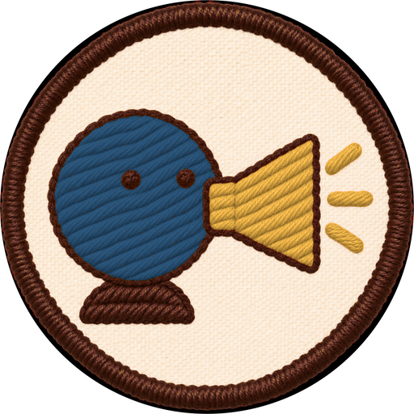
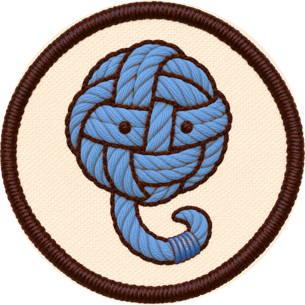
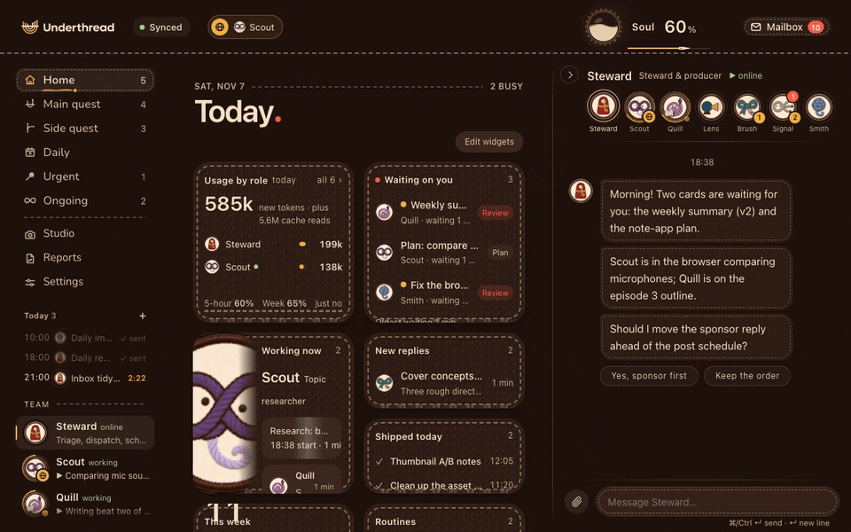
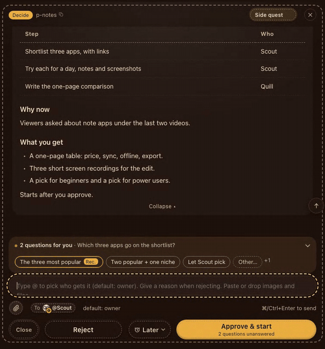
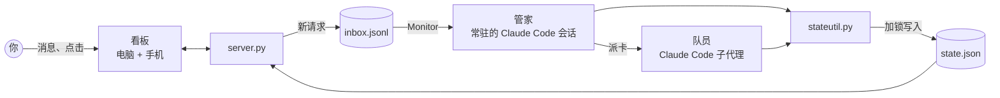

<div align="center">

<picture>
  <source media="(prefers-color-scheme: dark)" srcset="web/brand/wordmark-on-dark@2x.png">
  
</picture>

### 一个管家，一支 AI 小队，你只管点头。
#### 你只需要说：行、不行、再来一版。

[English](README.md) · **简体中文**


[**5 分钟跑起来**](#5-分钟跑起来) · [**认识队员**](#认识队员) · [**和小队过一天**](#和小队过一天) · [**文档**](#文档)

[](LICENSE)


</div>

**这是什么。** Underthread 是一个跑在你自己电脑上的看板，加上一支由 [Claude Code](https://docs.claude.com/en/docs/claude-code) 驱动的小队。一个常驻的 Claude Code 会话当**管家**：你在看板里说的话，它整理成卡片，再派给对应的专员（Claude Code 子代理）。专员交回来的是草稿、计划和文件，你来批准、驳回（写一句原因），或者回答它的问题。

**给谁用。** 已经在用 Claude Code、手上同时挂着一堆小事的人：查资料、写东西、做计划、修小工具、每天要做的杂事。比起盯着一个聊天窗口，你更想每天过一遍待审队列，那就适合你。

**要花什么。** 软件本身免费（MIT）。活是 Claude Code 干的，所以**会用掉你自己 Claude 订阅的额度**，而且管家全天在线，每张卡都要消耗额度。管家会看着用量：超过 85% 只排队不派新活，到 95% 就睡到额度窗口重置。

<p align="center"></p>

所有东西都在你自己的机器上。你不亲手发出去的东西，什么都不会出去。

> **还在早期。** 整个流程在一台机器上已经能从头跑到尾，但还有毛边。碰到问题欢迎开 issue。
>
> Underthread 是独立项目，**与 Anthropic 没有任何关联，也未获其认可或赞助**。Claude 和 Claude Code 是 Anthropic 的产品名。

---

## 认识队员

默认小队七个人。每人一枚刺绣徽章，干活的时候会拿起自己的小工具。

> **管家 = manager。** 文件、命令和 roster 里，管家的 id 是 `manager`（`manager.md`、`set-agent manager`）。其他人的 id 见第三列。

| | 谁 | Id | 做什么 |
|---|---|---|---|
|  | **Steward**（管家） | `manager` | 读你发的每条消息，整理成卡片、派出去，每天给你写日报。有活的时候摇一下小铃铛。 |
|  | **Scout**（研究员） | `scout` | 查资料、做对比、核事实，每条结论都带出处。放大镜不离手。 |
|  | **Quill**（写作） | `writer` | 管所有文字：文档、草稿、总结、消息。想事情的时候翻小本子。 |
|  | **Lens**（规划） | `director` | 把大活拆成步骤：计划、清单、复查。场景就绪时打一下场记板。 |
|  | **Brush**（设计） | `artist` | 图片、示意图和样稿，可以接你自己的 ComfyUI 机器。走过留下一点颜料。 |
|  | **Signal**（协调） | `ops` | 日程、跟进、消息草稿。会折纸飞机。 |
|  | **Smith**（工具） | `smith` | 维护看板和工具，动手前先备份。没事的时候织毛线。 |

想换一支队伍？名字、职责、语气、人数都在 `roster.json` 里；招聘市场还有 24 个现成岗位。做 B站 / YouTube / 小红书 的话，`presets/content-zh/` 里有一套中文自媒体团队预设（脚本、分镜、封面、发布排期），跑 `python3 tools/preset.py apply content-zh` 就能换过去。见[组建你自己的小队](#组建你自己的小队)。

---

## 5 分钟跑起来

### 需要什么

| 需要 | 为什么 |
|---|---|
| macOS 或 Linux | Windows 没测过 |
| Python 3.10 以上 | 只用标准库，不用 `pip install` |
| 2023 年以后的浏览器 | 页面是 ES module + import map：Safari / iOS 16.4+、Chrome / Edge 89+、Firefox 108+ |
| [Claude Code](https://docs.claude.com/en/docs/claude-code)，登录付费的 Claude 订阅 | 每个队员都是 Claude Code 子代理，干活用的是你的订阅额度 |
| 带 **Monitor** 工具的 Claude Code 版本 | 管家靠后台 Monitor 盯着 `inbox.jsonl`。没有它，你在看板里说的话没人接 |
| 用量来源（可选，二选一） | 终端里：Claude Code 的 `statusLine` 跑 `tools/statusline.py`（Pro 或 Max 订阅）。Claude 桌面 App 里：管家调用 App 自带的用量工具。两个都没有的话，用量卡显示「未接入用量」，85% / 95% 的刹车也不会生效 |

### 步骤

```bash
git clone https://github.com/dxu2/underthread.git && cd underthread
```
<!-- TODO(launch): 公开前这个地址必须能打开（2026-11-12 还是 404）。 -->

> **只想先看看？** 跑 `python3 server.py --demo`，打开 <http://127.0.0.1:8765>。不用装 Claude Code，就能看到小队在干活：管家开卡，队员亮起来、记进度、交草稿；你在页面上点什么，都会收到一句预设的回复。demo 在单独的 `.demo/` 目录里跑，每次启动重建，不会读写你真实的卡片。按 Ctrl-C 退出。`PORT=8766` 换端口；`--lang zh` 或 `--lang en` 设对话语言（默认跟 `$LANG`）。

**1. 启动看板。**

```bash
python3 server.py
```

第一次运行会把 `config.example.json`、`roster.example.json`、`state.example.json` 复制成 `config.json`、`roster.json`、`state.json`。
*你应该看到：* 终端打印 `Underthread → http://127.0.0.1:8765`。打开这个地址，首页上有几张示例卡。顶栏显示管家离线，这是正常的，第 3 步之后就会上线。

**2. 生成队员（必须）。**

```bash
python3 make_agents.py
```

它按 roster 给每个队员在 `.claude/agents/` 里写一个 Claude Code 子代理，并刷新 `manager.md` 里的派单表。**跳过这一步，派单全部失败**，因为管家找不到人。想改名字或角色，先改 `roster.json` 再跑；以后随时可以重跑。
*你应该看到：* `from roster.json: wrote 6 agents → …/.claude/agents: underthread-scout, underthread-writer, …` 和 `restart the manager session to pick them up`。派单表有变化时，还会多一行 `updated dispatch table in manager.md`。

**3. 叫醒管家。** 另开一个终端，在同一个目录里：

```bash
claude "Start the manager per manager.md"
```

不用复制任何文件：仓库自带 `.claude/settings.json`，让队员跑自己的辅助命令时不用每次问你，同时把用量喂给看板。保持原样就好；你自己要加的权限放进 `.claude/settings.local.json`（git 会忽略它，Claude Code 两个都读）。
*你应该看到：* 几秒内顶栏的管家状态变成在线，看板聊天里出现一句问候。

**4. 说句话。** 在聊天框里打一句需求，就像给同事发消息。
*你应该看到：* 出现一张新卡，某个队员的徽章亮起来，开始干活。

哪一步不对？看[排障](docs/troubleshooting.md)。完整安装（手机 App、推送、ComfyUI）见 [docs/setup-guide.md](docs/setup-guide.md)（英文）。

**以后怎么升级。** 有新版时，设置 → 系统 → 更新 会提示；点「更新」，会先在一份数据副本上试跑，再换到新版并重启看板，卡片、设置和 `local/` 都原样保留。「退回」回到更新前的版本。也可以在终端跑 `python3 tools/update.py check | apply | rollback`。前提是用上面的 `git clone` 安装：下载 zip 解压的目录不能自己升级（重新 clone 一份，把 `local/` 和 `*.json` 数据文件拷过去）。

> **想改看板本身？** 先复制一份目录，在副本里跑 `PORT=8799 NO_LOOPS=1 python3 server.py`，别碰你真实的卡片。

---

## 和小队过一天

<p align="center"></p>

**09:10 · 张口就来。** 在聊天里打一句话。管家回你，一张新卡出现，有个队员开始干活。不用填表，不用选模板。

<p align="center"></p>

**10:40 · 一个问题，不是一大段字。** 没人会把需要你拍板的事藏在草稿第四页。Scout 找到三个工具，想知道你更在意价格还是隐私：你看到两个按钮，Scout 推荐的那个排第一。「其他…」永远都在。

<p align="center"></p>

**11:30 · 大活？** 耗时长或有风险的活，先交计划。你不点头，什么都不会动。

**14:20 · 轻松审稿。** 每次交付都保留旧版本，v1 和 v2 可以并排看改了哪里。满意就批准。

<p align="center"></p>

**15:05 · 「不是这样。」** 驳回草稿，写一句原因。管家把这句话整理成给那位队员的规则提议，你确认后，他以后每次干活前都会先读。小队不会在同一个坑里摔两次。

<p align="center"></p>

**18:00 · 一页日报。** 管家写日报：等你处理的、今天完成的、还在做的、新采纳的规则、出了什么问题。

---

## 功能一览

- **手机上也能用。** 把看板加到主屏幕，就像一个 App，推送通知会避开免打扰时段。见[手机和推送](docs/phone-and-push.md)（英文）。

  <p align="center"></p>

- **一句话定时。** 「明天 9 点提醒我…」「每个工作日 9 点让 Scout 看看趋势」会变成「定时」页上的一条，有开关和一周的运行记录。
- **招聘市场。** 24 个岗位模板，每个三种性格，一键雇佣。
- **⌘K，或者直接按 `/`。** 搜索所有卡片和聊天记录。
- **一个信箱。** 回复、交付和通知都在这里，可筛选。
- **换个样子。** Underthread 的咖啡奶油配色，或者 Ink 黑玻璃；夜间、日间或跟随系统；再叠一层质感：针脚、毛衣、软皮、马鞍。

  <p align="center"></p>

- **中文或英文界面**，在设置里切换。
- **自动归档。** 完成很久的卡会挪走，看板保持轻快，搜索照样找得到。

---

## 组建你自己的小队

Underthread 不在乎你做什么工作。管家、卡片、审核、规则、看板，对任何团队都一样。三种方式改队伍：

1. **招聘市场**（左侧栏）。选个模板，点**直接雇**，新队员带着头像、角色笔记和代理文件直接入队。roster 里有 id 为 `hr` 的角色时，还可以点**面试**，让 HR 先问你几个问题。
2. **命令行。** `python3 tools/new_role.py plan|apply|retire|rehire|update`。
3. **手改。** 改 `roster.json` 和 `roles/<id>.md`，然后跑 `python3 make_agents.py`。

在 设置 → 角色 里还可以给队员**调岗**或让他**退休**。

<p align="center"></p>

完整说明（所有 roster 字段和一个实例）：[docs/custom-crew.md](docs/custom-crew.md)（英文）。

---

## 我们的承诺

1. **只出草稿。** 小队从不发布、发帖、上传、评论或往外发任何东西。这些由你来做。
2. **大事先问。** 耗时长或有风险的活先交计划，等你点头。
3. **不碰你的文件。** 队员只在 `work/<卡片 id>/` 里写新文件，不删也不覆盖你上传的东西，改代码和配置前先备份。
4. **数据留在家里。** 卡片、聊天、上传、日志、记忆都是项目目录里的文件，全部被 git 忽略。看板只监听 `127.0.0.1`。推送密钥和 token 在本机生成、权限 600，不会发给网页。用量数据从本机的 Claude Code 读取，也只留在本机。
5. **实话实说。** 每次交付都写明有几成把握、哪些没核实。

更多见 [.github/SECURITY.md](.github/SECURITY.md)（英文）。

---

## 怎么运转的



- **一个状态文件。** 所有东西都在 `state.json`，只有 `stateutil.py` 能写，写的时候加文件锁。
- **一个收件箱。** 你在看板里的操作都追加到 `inbox.jsonl`，管家盯着它，一条条处理。
- **按 roster 生成队员。** `make_agents.py` 把 `roster.json` 里的每一项变成一个 Claude Code 子代理。
- **不用构建。** 纯 HTML、CSS、JavaScript，由只用标准库的 Python 服务器提供。

完整循环、卡片生命周期、记忆放在哪：[docs/architecture.md](docs/architecture.md)（英文）。

---

## 文档

详细文档目前只有英文版。

| | |
|---|---|
| [docs/setup-guide.md](docs/setup-guide.md) | 完整安装：配置、roster、重启、ComfyUI、工具 |
| [docs/architecture.md](docs/architecture.md) | 各部分怎么配合、卡片生命周期、记忆 |
| [docs/custom-crew.md](docs/custom-crew.md) | 增加、修改、退休队员 |
| [docs/phone-and-push.md](docs/phone-and-push.md) | 手机 App、Tailscale Serve、推送 |
| [docs/troubleshooting.md](docs/troubleshooting.md) | 排障和常见问题 |
| [.github/CONTRIBUTING.md](.github/CONTRIBUTING.md) | 参与开发 |
| [.github/SECURITY.md](.github/SECURITY.md) | 安全模型和漏洞报告 |
| [CHANGELOG.md](CHANGELOG.md) | 更新记录 |

---

## 路线图

正在琢磨的想法，不是承诺：
- 一张卡依赖另一张时，队员之间直接交接。
- 在看板里直接编辑记忆，而不只是看。
- 带范围的批准：「这张卡都行」「这类改动都行」。
- 把整套东西打包成 Claude Code 插件。

不在这个仓库里的：和管家语音通话（作者自己的版本有），以及任何模型权重（whisper、ComfyUI 模型等各有各的许可）。

---

## 许可

代码采用 [MIT](LICENSE)。你接入的模型、字体、声音和图片各自保留原许可。自带字体（Nunito、Cinzel）采用 SIL Open Font License 1.1，许可文本在 `web/fonts/`。Underthread 的标志、徽章头像和质感贴图都是为本项目制作的，不含第三方作品。

名字和标志用来识别本项目。如果你分发改过的分支，请换一个名字。

<p align="center"><sub>一个人和一支不睡觉的小队做的。欢迎 issue 和想法。</sub></p>
