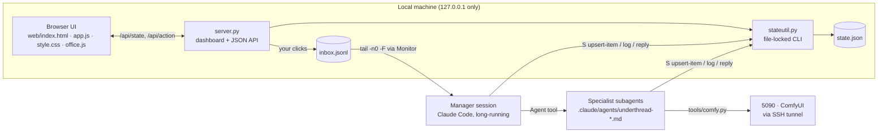

# Underthread: personal content team + local review dashboard

One long-running Claude Code **manager** session takes your instructions from a local dashboard, sends the work to
specialist **subagents**, and leaves you only to review and approve. Built for a 自媒体 team
(B站 / YouTube / 小红书). There are no Slack or email collectors: you give the orders.

> Items marked **(example)** are choices you can change: roles, platforms, paths.

---

## 1. What it is and why

| Problem | How the setup handles it |
|---|---|
| Too many content pieces to keep in your head | Every request becomes a card with a category, an owner and a stage |
| Context switching between ideas, scripts, covers, posts | The manager routes each card to a specialist and you review one queue |
| Fear of agents acting on your behalf | Agents produce **drafts, plans and files only**. You publish. Big work needs an approved plan first |
| Agents repeat the same mistakes | A rejection becomes a one-line rule you adopt. Agents read their rules on every dispatch |

What you do all day: open the dashboard, read the review queue, then approve, reject with a reason, or copy a draft out and publish it.

---

## 2. Architecture



### Components

| File | Role | Notes |
|---|---|---|
| `server.py` | Local HTTP server for the UI and JSON API. Also runs the daily-report timer, ComfyUI probe and roster sync as threads | Binds `127.0.0.1` only. Env: `PORT` (default 8765), `NO_LOOPS=1` |
| `stateutil.py` (`S`) | File-locked CLI every writer uses: `upsert-item`, `show`, `items`, `set-agent`, `log`, `reply`, `dm`, `say-mgr`, `inbox-pending`, `inbox-ack`, `lesson`, `notice`, `report`, `set-stamina` | Run with no args for usage |
| `state.json` | Single source of truth: items, agents, logs, lessons, reports, calendar, chat, DMs, mail, notices | **Never hand-edit.** Only through `stateutil.py` |
| `inbox.jsonl` | Append-only queue of your dashboard actions (`new_task`, `manager`, `dm`, `comment`, `approve`, `reject`, `done`, `reopen`, `dispatch`, `lesson`, `report_due`, `report_request`, `ping`) | The manager watches it. Never rewrite or truncate it |
| `manager.md` | The manager's startup instructions: triage, inbox handling, dispatch template, close-out review, daily report | Start the manager with a prompt pointing at it |
| `policy.md` | Dispatch table: which situations go to which role, which ask you first, priority, change log | The manager re-reads it on every triage |
| `team.md` | Principles, roles, pipeline | Human-readable overview |
| `roster.json` | One entry per role: names, title, duty, specialties, skills, role notes, agent file name, optional voice | Input to `make_agents.py` and to the dashboard |
| `make_agents.py` | Writes `.claude/agents/<agent_name>.md` (one subagent per role) from `roster.json` + shared hard rules, and refreshes the dispatch table in `manager.md` | Re-run after any roster change |
| `roles/*.md` | Role notes: `common.md` + one per role, each ending in `## Confirmed rules` | Agents read them every dispatch. Adopted rules are appended here |
| `tools/comfy.py` | ComfyUI client: `tunnel`, `ping`, `nodes`, `run` | For the artist role |

### Memory layers

| Layer | Location | Who writes it |
|---|---|---|
| Your main Claude memory | `~/.claude/projects/<this folder>/memory/` | You (via the manager). Agents only suggest |
| Per-agent memory | `.claude/agent-memory/<agent>/` (from `memory: project` in the agent file) | Each agent maintains its own |
| Role notes | `roles/<id>.md` | You (or adopted lessons). Agents never edit directly |
| Dispatch rules | `policy.md` | You or the manager, with a change-log line |

---

## 3. Roles (by function)

Each role is a custom subagent generated from `roster.json`. Names are placeholders. Rename freely.

| Role | Id | Responsibility |
|---|---|---|
| 管家 Steward (manager) | `manager` | The long-running main session. Triage, dispatch, relay, schedule (doubles as producer), daily report. Not a subagent |
| 研究员 Scout | `scout` | Topic pool, trend and benchmark breakdowns, research, fact-checking |
| 编剧 Writer | `writer` | Production doc, scripts, hooks, titles, descriptions, all copy |
| 导演 Director | `director` | Storyboard, shot list, edit plan, ffmpeg rough cut / subtitles / vertical slices |
| 美术 Artist | `artist` | Covers, thumbnails, concept art, b-roll stills via ComfyUI on the 5090 |
| 运营 Ops | `ops` | Per-platform packaging, publishing calendar, comment replies, analytics review |
| 工匠 Smith | `smith` | Tooling keeper: dashboard, scripts, ComfyUI pipeline. First responder for tool errors |

Roles are by **function**, not by project: main / side is the item's category. That way every correction about one craft accumulates as rules on one role.

### Categories

Only five: `main` 主线 (the current big production), `side` 支线 (steady updates), `daily` 日常委托 (one-offs),
`urgent` 紧急活动 (today's deadline, trending window, broken tooling), `ongoing` 常驻活动 (evergreen; lowest priority).

---

## 4. Dashboard UI tour

The UI toggles between Chinese and English, and between dark and light.

| Area | What it shows / does |
|---|---|
| **Review queue** (default page) | Pixel office (each agent at a desk; working agents glow and show a status bubble) above every card waiting on you, grouped "new since last visit", then by category |
| **Category pages** | 主线 / 支线 / 日常委托 / 紧急活动 / 常驻活动, grouped by stage |
| **委托板 Board** | Kanban: to do / in progress / your review / waiting / done. Drag to change stage |
| **Item detail** (click a card) | Summary, owner / category / stage selectors, the **draft** with a copy button and older versions, **confidence**, evidence, files, the **thread**; a composer (`@agent`, paste images); **批准 Approve**, **驳回 Reject** (with a reason), **完成 Mission complete**, **重开 Reopen** |
| **Chat panel** (right) | Direct channel to the manager, plus a DM thread per agent (relayed by the manager). Quick-reply buttons when the manager offers options |
| **TEAM** (left) | Each agent's status and current activity. Click to open their DM |
| **Ticker** | Rotating notices: manager offline with pending instructions, unowned urgent items, long waits, notices the manager pinned |
| **Stamina** | Click to set your monthly budget %. The thin bar under it is the manager's context use (`S set-stamina --focus`) |
| **WATCH** | Shipped this week, first-pass rate, 7-day sparkline, queue counts |
| **今日日程** | Your schedule for today and tomorrow (add with +). The manager plans the daily report around it |
| **日志 / 报告 / 频道 / 文档 / 角色 / 信箱** | Work log; daily reports; per-platform view; role notes and agent files; roster with stats and pending rule proposals (Adopt / Drop); mailbox of replies and updates |
| **Header** | Manager online state, next event, team count, ComfyUI tunnel state, unprocessed inbox count, theme / language, mailbox, report, ping manager |

---

## 5. Guardrails

| Guardrail | How it is enforced |
|---|---|
| **Drafts only** | Every agent file says it: never publish, post or upload anywhere. You copy drafts out yourself |
| **Plan-first** | Big work (>30 min, >20 generations, files outside `work/<item>/`) → plan → you approve → execute only what the plan lists |
| **Your files are safe** | Agents write under `work/<item-id>/` only. Never overwrite `uploads/` or source footage |
| **Close-out review → rules** | On every done or reject, the manager proposes at most 2 one-line rules. You adopt or drop. Adopted rules go to the role notes |
| **Rights** | Only assets and models you are allowed to use. Sources and seeds are recorded in evidence |
| **Local only** | The dashboard binds to 127.0.0.1. Never publish or deploy it |

---

## 6. Setup steps

### 6.1 Prerequisites

| Need | Check |
|---|---|
| Claude Code | `claude --version` |
| Python 3 (stdlib only) and a browser | `python3 --version` |
| ffmpeg (for the director) | `ffmpeg -version` |
| SSH access to the 5090 box running ComfyUI (for the artist) | `ssh <host> nvidia-smi` |

### 6.2 Copy and adapt the files

1. On first start, `server.py` copies the templates to their live names if they are missing:

| Template | Live name | What to fill in |
|---|---|---|
| `config.example.json` | `config.json` | `owner.display_name`, `report_time`, platform home links, `comfy.ssh_host` / ports |
| `roster.example.json` | `roster.json` | Your roles (names, duties, specialties, voice). `"enabled": false` hides a role |
| `state.example.json` | `state.json` | Nothing. It seeds three example cards you can archive |

2. Optional: copy `claude-settings.example.json` to `.claude/settings.json` so the team can run `stateutil.py`, `comfy.py` and ffmpeg without a prompt each time.

### 6.3 Define the roles

1. Edit `roster.json`. Per role: `id`, `name` / `name_en`, `title` / `title_en`, `duty` / `duty_en` (dashboard), `duty_long` and `specialties` (agent prompt), `notebooks` (role-note files), `agent_name` (subagent file name), `room` (`lead` / `script` / `signal` / `studio` / `art` / `tools`), `color`, optional `voice`, `model`, `tools`.
2. Generate the agent files:

```bash
python3 make_agents.py
```

3. That also refreshes the dispatch table in `manager.md`. Add a line to `policy.md` for the new role.

### 6.4 Start the dashboard server

```bash
python3 server.py
```

Open http://127.0.0.1:8765. Keep it in its own terminal tab.
For UI testing, run a scratch copy with `PORT=8799 NO_LOOPS=1 python3 server.py` from a copied folder, so the real `state.json` is never touched.

### 6.5 Start the manager session

From this folder:

```bash
claude "Start the manager per manager.md"
```

On startup the manager reads `team.md`, `policy.md`, `roles/common.md` and its handoff file, sets itself online, starts a Monitor on `tail -n0 -F inbox.jsonl` **before** reading the backlog, then works through `S inbox-pending`. The dashboard shows "管家 在线" once that first step runs.

### 6.6 ComfyUI (artist)

1. Set `comfy.ssh_host` in `config.json`.
2. `python3 tools/comfy.py tunnel`, then `python3 tools/comfy.py ping`. The header shows "5090 在线" within a minute.
3. In ComfyUI, export your workflows with **Save (API)** into `tools/workflows/`. `python3 tools/comfy.py nodes <wf>.json` lists which node inputs the artist can `--set`.

### 6.7 Restart notes

| You changed | Needed |
|---|---|
| `app.js` / `style.css` / other web files | Bump `?v=N` in `web/index.html`, then reload the tab |
| `server.py`, `stateutil.py` | Restart `server.py` |
| `roster.json` | `python3 make_agents.py`, then restart the manager session (the dashboard updates by itself) |
| `manager.md` | Restart the manager session |
| `policy.md`, `roles/*.md` | Nothing. Read on every triage or dispatch |

Before restarting the manager, make sure it has written `manager-handoff.md` (≤30 lines: priorities, open questions, running agents).

---

## 7. Skins and art

The kit ships an ornate dark skin and a parchment light skin, with no character art. Agents show a generated
pixel face until you add your own image as `avatars/<id>.png`. The pixel office is drawn in code (`web/office.js`):
rooms come from each role's `room`, colours from `color`. Use only art you are allowed to use.

## 8. Never copy someone else's data

If you share this kit, share code and templates only. Never `state.json`, `inbox.jsonl`, `uploads/`, `work/`,
`config.json`, `manager-handoff.md`, agent memories or role notes with personal rules.

## 9. Known gotchas

- Subagents do not persist between dispatches. Context lives in the item thread, `work/<item-id>/` and role notes. That is why agents call `S show` first.
- If the manager session dies, your clicks still queue in `inbox.jsonl`. The ticker warns you, and the next manager handles the backlog.
- `inbox-ack` is what stops the manager re-handling an entry after a restart. An entry that was handled but not acked gets handled twice.
- Approving a **plan** moves the card to "in progress". Approving a **deliverable** closes it.
