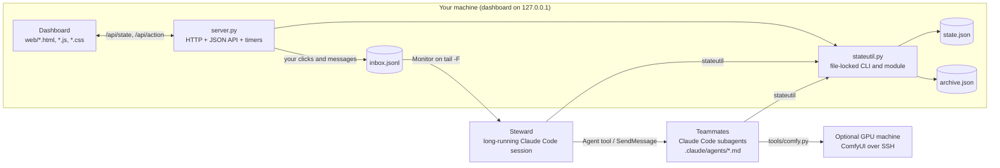

# How Underthread works

For contributors and the curious. If you only want to use it, the [README](../README.md) is enough.

## The pieces

| File | What it is |
|---|---|
| `server.py` | Standard-library HTTP server for the dashboard and its JSON API (the code is in `api/`, below). Also runs timers: daily report, schedules, archive sweep, ComfyUI probe (only when `config.json` has a `comfy` block), roster sync, push. `NO_LOOPS=1` turns the timers off |
| `stateutil.py` | The only writer of `state.json`. Every change goes through it under an exclusive file lock, so the server, the steward and every teammate can write at the same time. Run it with no arguments for the command list |
| `state.json` | The single source of truth: cards, agents' statuses, chat, DMs, mail, lessons, reports, schedules, usage. Never hand-edit it |
| `archive.json` | Finished cards moved out of `state.json` after 3 quiet days |
| `inbox.jsonl` | Append-only queue of what you did in the dashboard. Never rewrite or truncate it |
| `manager.md` | The steward's startup instructions |
| `policy.md` | Which kind of work goes to which teammate, what needs your OK first, priority |
| `team.md` | A human-readable overview of the team |
| `roster.json` | One entry per teammate. Input to `make_agents.py` and to the dashboard |
| `make_agents.py` | Turns `roster.json` + `roles/*.md` + shared hard rules into `.claude/agents/*.md` |
| `roles/*.md` | Role notes. `common.md` is read by everyone; each ends in `## Confirmed rules` |
| `stateutil.py` | The command line every agent uses (`python3 stateutil.py …`). It also re-exports every name from `core/`, so `import stateutil as S` keeps working |
| `core/` | The code behind it: `paths` (file locations), `store` (lock, read, write, archive, inbox), `items`, `asks`, `chat`, `agents`, `handoffs`, `lessons`, `schedule_store` and `schedules` (parsing and next-run maths), `config` and `migrate` (defaults and data upgrades), `ext` (extension loading and hooks), `registry` (the extension registry: API number, card kinds, jobs, extension web files; `docs/extensions.md`). Other scripts read `roster.json` and `config.json` through `core.config` |
| `server.py` | The entry point only: `python3 server.py` (`PORT`, `NO_LOOPS`, `--demo`). It re-exports every `api/` name, so `local/ext` server extensions that use `srv.<name>` keep working |
| `api/` | The server code. `router.py` holds the route table (`@route("GET", "/api/health")`) and the action table (`@action("approve")`, one function per `/api/action` kind); `routes/` has one module per feature (`state`, `actions`, `schedules`, `snooze`, `push`, `health`, `secret`, `hr`, `media`, `docs`, `voice`, `update`, `web`); `http.py` is the request handler (guards, gzip, files) and dispatches through the table; `loops.py` holds the background threads; `ctx.py` the shared paths and config. `core/` never imports `api/` |
| `web/` | Plain HTML, CSS and JavaScript. No build step: `index.html` + `main.js`, scripts in `web/js/`, stylesheets in `web/css/`, icons in `web/icons/` ([layout.md](layout.md)) |

## The loop

1. **You act.** You type in the chat, create a card, comment, approve, reject, answer a question, or a schedule fires. `server.py` records the change in `state.json` and appends one JSON line to `inbox.jsonl` (`new_task`, `manager`, `comment`, `approve`, `reject`, `answer`, `dm`, `schedule_due`, `report_due`, …).
2. **The steward hears it.** The steward runs a Claude Code **Monitor** on `tail -n0 -F inbox.jsonl`, so each new line arrives as an event. It started the Monitor *before* reading the backlog (`stateutil.py inbox-pending`), so nothing is lost between the two.
3. **The steward triages.** It sets the card's category and owner using `policy.md`, writes a clear title and summary, or answers you directly if no teammate is needed.
4. **The steward dispatches.** It marks the teammate working (`set-agent <id> --status working --item <card>`), moves the card to `doing`, and sends the job to that teammate's subagent. Each role keeps one standing instance, reused across cards with `SendMessage`, so it keeps context.
5. **The teammate works and delivers.** It reads the card (`stateutil.py show`), its role notes and its memory, writes files under `work/<card-id>/`, and delivers with `stateutil.py upsert-item --stage review --draft-file …`. Every delivery keeps the previous one as a version.
6. **The steward checks and acks.** It checks the card landed in `review` with a draft, sets the teammate idle, and acks the inbox entry (`inbox-ack`) so a restart won't handle it twice. Then it waits for the next event.

## Card lifecycle

Stages: `todo` → `doing` → `review` (waiting on you) → `done`. `waiting` means blocked on someone outside the team.

| Kind | What it means | Approve does | Reject does |
|---|---|---|---|
| `plan` | "Here's what I'm about to do" | Moves the card to `doing`; the teammate executes only what the plan lists | Teammate revises; the steward may propose a rule |
| `deliverable` | Finished work for you to take | Closes the card (`done`) | Teammate revises with your reason |
| `question` | The teammate needs a decision | (You answer the question; options show as buttons) | — |
| `task` | Plain work item | — | — |

Because approving a deliverable closes the card, a multi-step job is split into **child cards**, one per step, tagged with the parent's id.

Categories (renamable in the UI): `main` (Main quest), `side` (Side quest), `daily` (Errands), `urgent` (Urgent), `ongoing` (Dailies: recurring routines).

## Rules: how the crew learns

When you reject a draft, or close a card where you corrected something, the steward may propose up to two one-line rules (`stateutil.py lesson`). You adopt or drop each one on the dashboard. Adopted rules are appended to `roles/<id>.md` under `## Confirmed rules`, and every teammate reads its role notes at the start of every job.

## Where memory lives

| Layer | Location | Who writes it |
|---|---|---|
| Card thread and files | `state.json` (thread, versions) and `work/<card-id>/` | Teammates and the steward, through `stateutil.py` |
| Role notes and confirmed rules | `roles/<id>.md` | You (adopted rules); teammates never edit them |
| Dispatch policy | `policy.md` | You, or the steward with a change-log line |
| Per-teammate memory | `.claude/agent-memory/<agent>/` | Each teammate keeps its own (facts it will need again) |
| Steward handoff | `manager-handoff.md` (≤30 lines) | The steward, before restarts and after decisions |
| Teammate handoffs | `work/<role>-handoff.md` | Each teammate at every hand-back |
| Your Claude Code memory | `~/.claude/projects/<this folder>/memory/` | Claude Code; the steward on your behalf |

All of these except `roles/`, `policy.md` and `team.md` are ignored by git.

## Safety lines

- The dashboard binds to `127.0.0.1`, checks the `Host` header (localhost, this machine's names, `*.ts.net`, plus `allowed_hosts`), and rejects cross-site POSTs. See [SECURITY.md](../.github/SECURITY.md).
- Teammates produce drafts only and never post anywhere. Big work needs an approved plan. These rules are written into every agent file by `make_agents.py`.
